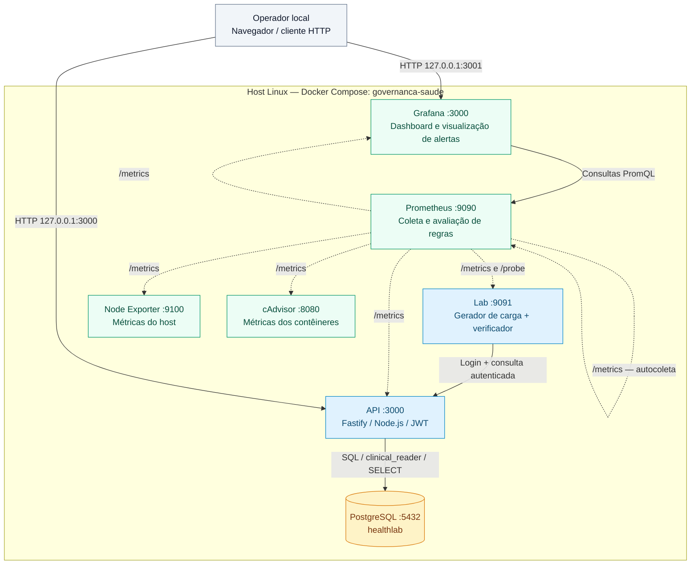
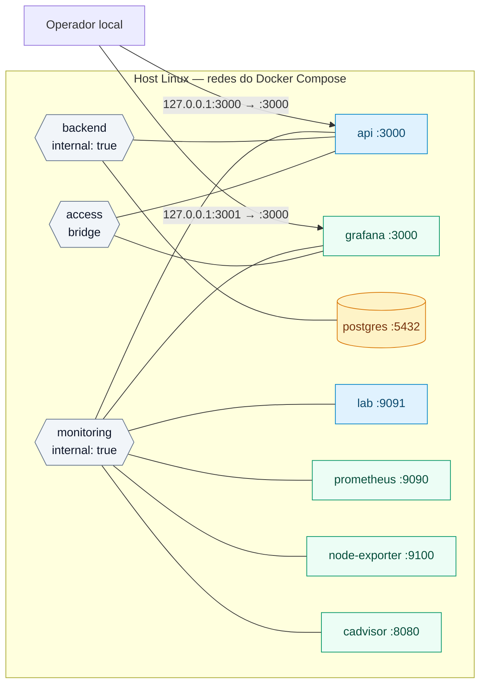

# Painel de Governança em Cibersegurança — Saúde

Laboratório da **Sprint 1**, com prontuários inteiramente fictícios, consulta autenticada e Dashboard v0.1. Prazo de referência: duas semanas; esforço previsto: 20–40 horas totais, sem pressupor número de pessoas.

Sprint 1 concluída e validada em 17/09/2026. Consulte o [relatório com a DoD](docs/relatorio-sprint1.md) e as [evidências revisadas](evidence/validated/sprint1/README.md). A entrega combina a sessão de falhas de 10/09 com a validação de retomada de 17/09, sem misturar os dois períodos.

## Começar

Use **Ubuntu 24.04 ou Ubuntu 26 ou superior**, em uma máquina x86_64 ou ARM64 com 6 CPUs lógicas, 8 GiB de RAM e 15 GiB livres para imagens e dados. O teste de memória aceita ao menos 7,5 GiB reconhecidos pelo kernel. É necessário acesso à internet e permissão de `sudo` quando faltarem pacotes. Versões futuras do Ubuntu dependem da disponibilidade do repositório oficial Docker para seu codinome.

Com Git instalado e acesso a este repositório privado:

```bash
git clone https://github.com/GuiLuiz12/integrador4s.git
cd integrador4s
./bootstrap.sh
npm run setup
npm start
```

Cada comando tem uma função:

1. **`./bootstrap.sh`** prepara apenas Node/npm. Preserva uma instalação funcional de Node 22+; quando ausente, instala Node 22.23.2 com npm a partir do [arquivo oficial](https://nodejs.org/dist/v22.23.2/), verificando SHA-256. Instala também ferramentas de download ausentes, se necessário. Não instala Docker nem inicia serviços.
2. **`npm run setup`** verifica sistema e recursos, instala Docker/Compose/Buildx/Python e outros requisitos ausentes, inicia o daemon Docker se necessário e cria ou preserva `.env`. **Não sobe os contêineres do laboratório.**
3. **`npm start`** constrói e sobe os sete serviços. Só informa que está pronto após confirmar a consulta autenticada, o Grafana, a cobertura de monitoramento de 100% e as métricas dos sete serviços. Mostra o painel e onde consultar sua senha.

**Não execute `npm ci` para operar o laboratório.** As dependências da aplicação são instaladas nas imagens Docker. `npm ci` é necessário somente para desenvolvimento e ferramentas visuais opcionais. Não é necessário pnpm ou Yarn.

O bootstrap instala em `/usr/local/lib/governanca-saude/`, com atalhos em `/usr/local/bin`. Não altera nvm nem sobrescreve instalações de outros gerenciadores. Se houver Node incompatível antes desses atalhos no PATH, informa o conflito: ative Node 22+ com npm no gerenciador existente ou ajuste o PATH antes de repetir. Instalações compatíveis, incluindo a desta máquina, são preservadas. A instalação Docker segue o [repositório APT oficial](https://docs.docker.com/engine/install/ubuntu/), sem remover pacotes conflitantes.

Para conferir o host sem instalar, gerar arquivos ou iniciar serviços:

```bash
npm run setup:check
```

Você pode repetir bootstrap e setup: instalações compatíveis, senhas, volumes e dados existentes serão preservados. Se o `.env` tiver sido perdido mas os volumes ainda existirem, o setup pedirá a restauração desse arquivo. Instalações Docker parciais com pacotes conflitantes também serão identificadas, sem desinstalação automática. Execute os comandos como usuário normal; os scripts solicitam sudo quando necessário.

Os coletores exigem Docker Engine local convencional, cgroups v2, dados em `/var/lib/docker` e o socket containerd padrão em `/run/containerd/containerd.sock`; Docker Desktop, rootless e daemon remoto ficam fora deste setup. Os scripts usam `sudo` para acessar Docker quando o usuário não tem permissão no socket; não alteram grupos ou permissões globais. Por isso a senha de sudo pode ser solicitada novamente em operações posteriores.

Consulte [validação dos comandos npm](docs/validacao-comandos.md) para distinguir testes reais, simulados e limitações de plataforma. Reconhecer uma versão futura do Ubuntu não garante que Docker ou Chromium já forneçam os pacotes necessários.

## Usar depois do setup

| O que você quer fazer | Comando ou local | Resultado |
|---|---|---|
| Acompanhar indicadores e alertas | [Grafana](http://localhost:3001/d/saude-v01) | Painel preenchido pela coleta automática |
| Descobrir todas as ações | `npm run help` | Catálogo com pré-requisitos, argumentos, duração e efeitos |
| Consultar endereços e logins | `npm run access` | URLs, usuários e variáveis de senha; nenhum segredo impresso |
| Ver os serviços | `npm run status` | Estado dos sete contêineres |
| Acompanhar logs da API | `npm run logs -- api` | Últimas 100 linhas e novos eventos; Ctrl+C encerra a leitura |
| Acompanhar todos os logs | `npm run logs` | Logs locais de todos os serviços |
| Confirmar login e consulta clínica | `npm run check` | Teste do fluxo, sem expor token ou prontuário |
| Consultar vitalidade e prontidão | `npm run health` | Estado dos dois endpoints da API |
| Entrar no PostgreSQL | `npm run db` | Terminal `psql` dentro do contêiner |
| Encerrar por enquanto | `npm stop` | Para o laboratório e preserva os dados |
| Voltar a usar | `npm start` | Reativa e verifica os serviços já configurados |

Use os comandos dentro da pasta do repositório. Argumentos adicionais vêm depois de `--`, como em `npm run logs -- postgres`. Os scripts resolvem os caminhos do Compose e do `.env` automaticamente. `npm start`, `npm stop` e `npm test` dispensam a palavra `run`.

O gerador já produz uma consulta fictícia por segundo. Não é necessário disparar um experimento para começar a ver dados. Gráficos que usam janela de cinco minutos precisam desse tempo para amadurecer. Os experimentos opcionais estão em [Demonstrar](#demonstrar).

## Acessos locais

`npm run setup` cria `.env` com segredos aleatórios e permissão 0600, sem exibi-los. Não sobrescreve um arquivo existente válido. Abra esse arquivo **localmente** para obter `GRAFANA_PASSWORD`; não o inclua em screenshots ou relatórios. Login do painel: `admin`.

- **Painel:** http://localhost:3001/d/saude-v01
- **OpenAPI:** http://localhost:3000/openapi.json
- **Recuperação:** http://localhost:3000/runbook
- **Vitalidade / prontidão:** http://localhost:3000/health/live e http://localhost:3000/health/ready

Aguardar aproximadamente 45 s para preencher alvos e regras; gráficos com janela de cinco minutos precisam de histórico. O gerador inicia automaticamente em uma consulta por segundo.

Na API, `POST /auth/login` recebe JSON com `username` e `password`; o token retornado autentica `GET /prontuarios/:id` com `Authorization: Bearer <token>`. As identidades e respectivas variáveis no `.env` são:

| Usuário | Variável da senha | Uso |
|---|---|---|
| `profissional1` | `PROF_1_PASSWORD` | Consulta clínica e gerador |
| `profissional2` | `PROF_2_PASSWORD` | Consulta clínica |
| `monitor` | `PROBE_PASSWORD` | Verificação automática |

Não há edição de prontuários, cadastro público ou acesso a dados reais. OpenAPI é a especificação JSON da API; não há interface web de prontuário nesta sprint.

Para acessar o PostgreSQL, executar **na raiz do projeto**, com os serviços ativos:

```bash
npm run db
```

No `psql`, `\dt` lista as tabelas, `SELECT count(*) FROM prontuarios;` verifica o total e `\q` sai. O administrador configurado é `lab_owner` (`POSTGRES_PASSWORD`); a aplicação usa `clinical_reader` (`APP_DB_PASSWORD`), com permissão somente de leitura. A conexão acima usa o socket local dentro do contêiner. O banco não possui porta publicada no host.

Também é possível consultar diretamente: `npm run db -- -c 'SELECT count(*) FROM prontuarios;'`. Prometheus, Node Exporter, cAdvisor e gerador permanecem acessíveis somente nas redes internas do projeto.

## Demonstrar

```bash
npm run metrics:query -- 'lab:collection_coverage_percent'
npm run simulate:load -- 5 600
npm run simulate:auth-failures
npm run simulate:db-outage -- 120
npm run check
npm run evidence:export
```

As simulações alteram o laboratório: carga ampliada, dez falhas de autenticação e indisponibilidade do banco. `simulate:db-outage` restaura o banco ao terminar ou receber Ctrl+C. `npm run simulate:collector-outage -- 90` interrompe e restaura o gerador/verificador. Recuperação manual: `npm run db:restore` e `npm run collector:restore`.

Para a sequência completa de **60 minutos reais**, começar com cobertura de 100%:

```bash
npm run session:run
```

A sessão inclui carga ampliada por dez minutos, dez logins inválidos, queda do banco por dois minutos, recuperação e interrupção do verificador por 90 s. Evidências ficam em `evidence/runs/`, ignorado pelo Git. O histórico não é fabricado nem preenchido retroativamente. Ver [roteiro](docs/demonstracao.md) e [relatório de validação](docs/relatorio-sprint1.md).

Após a sessão: `npm run session:summary -- evidence/runs/session-<horário>` valida os arquivos e gera `summary.json`. Para exportar a última hora sem executar uma sessão, use `npm run evidence:export`.

## Validar o ambiente

Com os serviços ativos, estes comandos verificam o laboratório:

```bash
npm run config:check
npm run test:rules
npm run check
npm run test:integration
```

A integração verifica registros, permissões, inicialização idempotente, endpoints, coleta, portas e limites. Os testes de regras não provocam falhas nos serviços ativos.

### Testar instalação do zero no Ubuntu 26.04

```bash
npm run test:ubuntu26
```

Este teste opcional usa QEMU/KVM no host, com Python 3.11+, Git e cliente SSH. Requer acesso a `/dev/kvm`, seis CPUs, 10 GiB de RAM **livre**, 25 GiB livres em `/tmp` e internet. Usa uma VM com seis vCPUs, 8 GiB de RAM e disco de 40 GiB. Não é requisito para operar o laboratório.

O roteiro baixa a [imagem oficial Ubuntu 26.04](https://cloud-images.ubuntu.com/releases/26.04/release/), confere SHA-256 e envia uma cópia do código atual, incluindo alterações locais, sem `.env`, dependências ou credenciais Git. Instala Node/npm e Docker dentro da VM, sobe o laboratório e verifica integração, regras e preservação após parada/retomada. O usuário de teste não pertence ao grupo Docker, exercitando o acesso por sudo.

Não compartilha o socket Docker ou os volumes do host. SSH e os metadados de inicialização usam somente portas locais temporárias. Logs e resultado ficam em `evidence/runs/ubuntu26-install-<horário>/`; o teste informa o diretório para acompanhar `installation.log`. Em sucesso, encerra a VM e remove seu disco e sua chave SSH; a imagem base fica em `/tmp/integrador4s-ubuntu26-test/` para reutilização. Em falha, encerra a VM e informa o diretório privado de diagnóstico que foi preservado. A duração depende da rede, normalmente de 15–30 minutos.

## Desenvolver e manter o código

Esta seção é opcional para quem vai alterar o projeto. Node/npm já são preparados pelo bootstrap. Execute `npm ci` antes de compilar, testar, gerar o dashboard ou usar as ferramentas visuais.

| Script npm | Para que serve | Quando usar |
|---|---|---|
| `npm run build` | Compila TypeScript para `dist/` | Validar alterações na aplicação |
| `npm test` | Executa testes de código e dos scripts com isolamento | Verificar alterações; não é a sessão real de uma hora |
| `npm run dashboard` | Gera `dashboards/saude.json` | Depois de editar `scripts/dashboard.mjs` |
| `npm run start:api` | Inicia apenas a API compilada fora do Compose | Desenvolvimento manual, com banco e variáveis preparados |
| `npm run start:lab` | Inicia apenas gerador/verificador compilados fora do Compose | Desenvolvimento manual, com API e variáveis preparados |

O dashboard é provisionado automaticamente. Ao alterar sua definição, versione a origem e o JSON gerado juntos; `npm start` mantém o laboratório configurado. `start:api` e `start:lab` são comandos avançados para componentes isolados; para usar o laboratório completo, execute `npm start`.

Para a validação visual opcional de desenvolvimento:

```bash
npm run browser:setup
npm run dashboard:verify
```

`browser:setup` instala Chromium e bibliotecas do sistema; pode solicitar sudo. As capturas ficam em `evidence/runs/dashboard/`, sem tela de login. `dashboard:verify` aceita `-- --from ISO --to ISO --output-dir PASTA`; as duas datas devem ser informadas juntas. Sem intervalo explícito, usa a última hora. As consultas e imagens usam o mesmo período. As ferramentas compartilham o cache padrão do Playwright, podendo usar `PLAYWRIGHT_BROWSERS_PATH` quando definido.

`npm run alerts:capture` observa os dois alertas por até 70 minutos e salva em `evidence/runs/alerts/`, sem provocar falhas. Execute em outro terminal antes da sessão. Pode receber o início ISO de uma sessão com `npm run alerts:capture -- ISO_INÍCIO`.

## Encerrar e recuperar

`npm stop` encerra apenas este projeto e preserva volumes. `npm start` recupera banco e histórico. Não há comando de limpeza de volumes neste fluxo. Para recuperar somente um componente, use `npm run db:restore` ou `npm run collector:restore` e confirme com `npm run check` e o painel.

Não regenere `.env` mantendo volumes existentes: senhas do banco, usuários iniciais e administrador Grafana são inicializadas na primeira criação. Rotações exigem alteração coordenada no serviço e no segredo, não somente edição do arquivo.

Somente as portas 3000 e 3001 são publicadas, vinculadas a loopback. A rede do banco e a de monitoramento são internas; uma terceira rede de acesso conecta apenas API e Grafana para permitir a publicação local. Montagens especiais do host ficam restritas aos coletores. Os sockets Docker e containerd montados como somente leitura ainda permitem chamadas às APIs dos daemons; trate cAdvisor como componente de confiança e não o exponha. O socket containerd é necessário para observar contêineres no armazenamento padrão de instalações novas do Docker 29.

## Documentação

- [Arquitetura e implantação futura](docs/arquitetura.md)
- [Inventário e cobertura](docs/inventario.md)
- [Catálogo dos indicadores](docs/indicadores.md)
- [Procedimento de recuperação](docs/recuperacao.md)
- [Glossário](CONTEXT.md)
- [Logs e evidências](logging/README.md)
- [Casos de teste autorizados](security/README.md)
- [Relatório e checklist de conclusão da Sprint 1](docs/relatorio-sprint1.md)
- [Evidências revisadas da Sprint 1](evidence/validated/sprint1/README.md)

Centralização de logs, KRIs, registro formal de riscos, vulnerabilidades, conformidade, workflow de ações e implantação efetiva na nuvem não fazem parte desta sprint.

# Topologia — integrador4s

Arquitetura definida na branch `main`, commit `09544272edb04a30653c01a9350e2b4ae8fc2606`, de 17/09/2026. Análise estática do código e das configurações; não representa uma inspeção de um ambiente em execução.

O laboratório de governança em cibersegurança para saúde tem sete serviços Docker em um único host Linux. A consulta autenticada de prontuários fictícios é o fluxo assistencial observado.

## Componentes e chamadas



As setas indicam quem inicia a chamada. Linhas contínuas representam consultas da aplicação ou do dashboard; linhas pontilhadas representam coleta iniciada pelo Prometheus, a cada 15 segundos. As respostas percorrem o caminho inverso.

O serviço `lab` reúne dois papéis no mesmo contêiner: o gerador acessa a API como `profissional1`; o verificador faz login como `monitor` e consulta o prontuário 1 quando o Prometheus chama `/probe`. O gerador inicia com uma consulta por segundo. A API autentica com JWT e consulta o banco usando `clinical_reader`, com acesso somente de leitura às tabelas `professionals` e `prontuarios`.

## Redes e portas



Neste diagrama, linhas sem seta significam participação na rede, não chamadas ou regras de firewall.

| Rede | Serviços conectados | Configuração |
|---|---|---|
| `access` | API, Grafana | Bridge; permite a publicação local das portas e conexões de saída desses dois serviços |
| `backend` | API, PostgreSQL | `internal: true`; banco sem porta publicada |
| `monitoring` | API, Lab, Prometheus, Grafana, Node Exporter, cAdvisor | `internal: true`; comunicação de monitoramento e tráfego Lab → API |

| Acesso no host | Destino no contêiner | Finalidade |
|---|---|---|
| `127.0.0.1:3000` | `api:3000` | API, OpenAPI, saúde e procedimento de recuperação |
| `127.0.0.1:3001` | `grafana:3000` | Dashboard `/d/saude-v01` |

As demais portas aparecem apenas nas redes do Compose. O repositório não define IPs fixos ou sub-redes com CIDR próprio; os serviços usam nomes DNS do Docker. Os contêineres de API e Grafana participam de múltiplas redes, conforme a tabela.

## Observabilidade e persistência

Há sete alvos de coleta: `api`, `probe`, `lab`, `node`, `cadvisor`, `prometheus` e `grafana`. Os jobs `probe` e `lab` usam o mesmo serviço, em endpoints diferentes. PostgreSQL não tem exporter próprio: o laboratório observa seu impacto pelo fluxo autenticado, pela prontidão da API e pelos recursos coletados pelo cAdvisor.

Node Exporter lê os recursos do host. cAdvisor lê metadados do host e o socket Docker; as métricas de contêineres retidas pelo Prometheus são filtradas para o projeto `governanca-saude`.

| Serviço | Volume persistente | Conteúdo |
|---|---|---|
| PostgreSQL | `postgres_data` | Dados fictícios e identidades |
| Prometheus | `prometheus_data` | Séries temporais; retenção de até 7 dias, também limitada a 2 GB |
| Grafana | `grafana_data` | Estado persistente do Grafana |

O Prometheus avalia `ConsultaAssistencialIndisponivel` e `FalhaDeColeta`; o Grafana mostra as métricas e os alertas no dashboard. Não há Alertmanager ou serviço de notificações definido no Compose. Os logs permanecem locais no Docker, com rotação de 3 × 10 MB por serviço.

A entrega é local, sem frontend clínico separado, serviços gerenciados ou alta disponibilidade. A implantação em VM e o acesso por túnel SSH são descritos como evolução futura, não como recursos provisionados.

## Fontes verificadas

- [Compose: serviços, redes, portas e volumes](https://github.com/GuiLuiz12/integrador4s/blob/09544272edb04a30653c01a9350e2b4ae8fc2606/infra/compose.yaml)
- [Prometheus: alvos e frequência de coleta](https://github.com/GuiLuiz12/integrador4s/blob/09544272edb04a30653c01a9350e2b4ae8fc2606/monitoring/prometheus.yml)
- [Regras e alertas](https://github.com/GuiLuiz12/integrador4s/blob/09544272edb04a30653c01a9350e2b4ae8fc2606/monitoring/rules.yml)
- [Datasource do Grafana](https://github.com/GuiLuiz12/integrador4s/blob/09544272edb04a30653c01a9350e2b4ae8fc2606/dashboards/provisioning/datasources/prometheus.yml)
- [API: autenticação, rotas e métricas](https://github.com/GuiLuiz12/integrador4s/blob/09544272edb04a30653c01a9350e2b4ae8fc2606/apps/api/app.ts)
- [Acesso da API ao PostgreSQL](https://github.com/GuiLuiz12/integrador4s/blob/09544272edb04a30653c01a9350e2b4ae8fc2606/apps/api/repository.ts)
- [Inicialização e permissões do banco](https://github.com/GuiLuiz12/integrador4s/blob/09544272edb04a30653c01a9350e2b4ae8fc2606/infra/postgres/001-init.sh)
- [Gerador e endpoint de verificação](https://github.com/GuiLuiz12/integrador4s/blob/09544272edb04a30653c01a9350e2b4ae8fc2606/apps/lab/server.ts)
- [Fluxo de verificação](https://github.com/GuiLuiz12/integrador4s/blob/09544272edb04a30653c01a9350e2b4ae8fc2606/apps/lab/probe.ts)
- [Arquitetura e implantação futura](https://github.com/GuiLuiz12/integrador4s/blob/09544272edb04a30653c01a9350e2b4ae8fc2606/docs/arquitetura.md)
- [Logs locais](https://github.com/GuiLuiz12/integrador4s/blob/09544272edb04a30653c01a9350e2b4ae8fc2606/logging/README.md)

Os arquivos `.mmd` acompanham este documento para edição dos diagramas em Mermaid.
