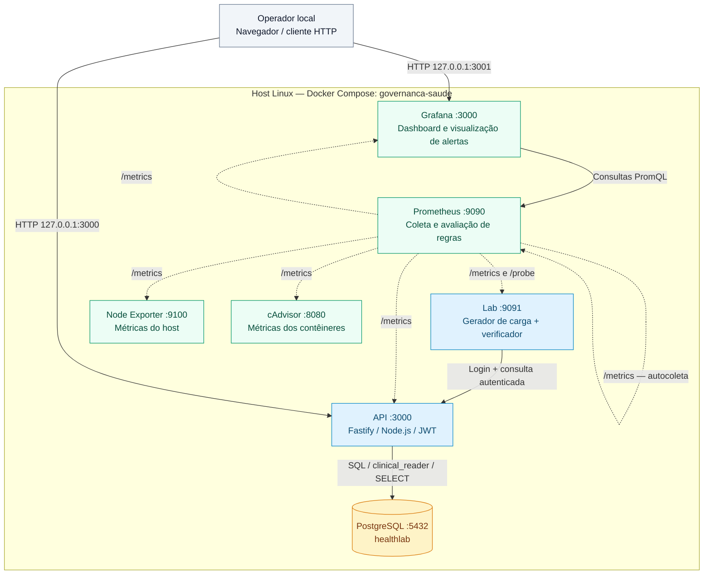
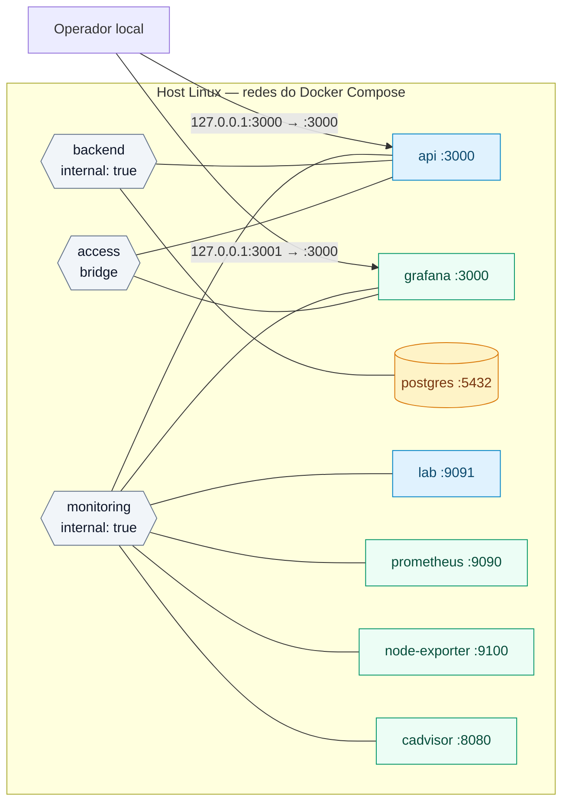

# Arquitetura e topologia

Sete serviços Docker em um único host Linux sustentam a consulta autenticada de prontuários fictícios. A API usa apenas SELECT; o perfil clínico lê todos os registros fictícios e não representa autorização por vínculo de um sistema de produção.

Os diagramas abaixo consolidam a topologia antes anexada ao README, cuja origem é a análise estática do [commit de 17/09/2026](https://github.com/GuiLuiz12/integrador4s/tree/09544272edb04a30653c01a9350e2b4ae8fc2606). Essa inspeção não comprova a execução de um ambiente. As fontes atuais são o [Compose](../infra/compose.yaml), a [configuração do Prometheus](../monitoring/prometheus.yml), as [regras](../monitoring/rules.yml) e os módulos de [API](../apps/api/app.ts) e [gerador/probe](../apps/lab/server.ts).

Instalação, operação e testes estão no [manual principal](../README.md). O relatório da Sprint 2 é um documento estático; a API não serve seus dados ou fontes.

## Componentes e chamadas

As setas indicam quem inicia a chamada. Linhas contínuas representam consultas da aplicação ou do dashboard; linhas pontilhadas representam coleta iniciada pelo Prometheus, a cada 15 segundos. As respostas percorrem o caminho inverso.

O serviço `lab` reúne dois papéis no mesmo contêiner: o gerador acessa a API como `profissional1`; o verificador faz login como `monitor` e consulta o prontuário 1 quando o Prometheus chama `/probe`. O gerador inicia com uma consulta por segundo. A API autentica com JWT e consulta o banco usando `clinical_reader`, com acesso somente de leitura às tabelas `professionals` e `prontuarios`.

## Redes e portas

Neste diagrama, linhas sem seta significam participação na rede, não chamadas ou regras de firewall.

| Rede | Serviços conectados | Configuração |
|---|---|---|
| `access` | API, Grafana | Bridge; permite a publicação local das portas e conexões de saída desses dois serviços |
| `backend` | API, PostgreSQL | `internal: true`; banco sem porta publicada |
| `monitoring` | API, Lab, Prometheus, Grafana, Node Exporter, cAdvisor | `internal: true`; comunicação de monitoramento e tráfego Lab → API |

| Acesso no host | Destino no contêiner | Finalidade |
|---|---|---|
| `127.0.0.1:3000` | `api:3000` | API, OpenAPI, saúde e procedimento de recuperação |
| `127.0.0.1:3001` | `grafana:3000` | Dashboard `/d/saude-v01` |

As demais portas aparecem apenas nas redes do Compose. O repositório não define IPs fixos ou sub-redes com CIDR próprio; os serviços usam nomes DNS do Docker. Os contêineres de API e Grafana participam de múltiplas redes, conforme a tabela.

## Observabilidade e persistência

Há sete alvos de coleta: `api`, `probe`, `lab`, `node`, `cadvisor`, `prometheus` e `grafana`. Os jobs `probe` e `lab` usam o mesmo serviço, em endpoints diferentes. PostgreSQL não tem exporter próprio: o laboratório observa seu impacto pelo fluxo autenticado, pela prontidão da API e pelos recursos coletados pelo cAdvisor.

Node Exporter lê os recursos do host, incluindo outros processos e projetos. cAdvisor lê metadados e os sockets Docker e containerd; as métricas de contêineres retidas pelo Prometheus são filtradas para o projeto `governanca-saude`. Os limites configurados somam 5,75 CPUs e 7 GiB. Os sockets montados como somente leitura ainda permitem chamadas às APIs dos daemons; cAdvisor é um componente de confiança sem porta pública.

| Serviço | Volume persistente | Conteúdo |
|---|---|---|
| PostgreSQL | `postgres_data` | Dados fictícios e identidades |
| Prometheus | `prometheus_data` | Séries temporais; retenção de até 7 dias, também limitada a 2 GB |
| Grafana | `grafana_data` | Estado persistente do Grafana |

O Prometheus avalia `ConsultaAssistencialIndisponivel` e `FalhaDeColeta`; o Grafana mostra as métricas e os alertas no dashboard. Não há Alertmanager ou serviço de notificações definido no Compose. Os logs permanecem locais no Docker, com rotação de 3 × 10 MB por serviço.

A entrega é local, sem frontend clínico separado, serviços gerenciados ou alta disponibilidade. A implantação em VM e o acesso por túnel SSH são descritos como evolução futura, não como recursos provisionados.

## Comportamento do fluxo observado

Gerador e probe compartilham o serviço `lab`, mas usam identidades diferentes. O gerador reutiliza token por até 14 minutos; o probe autentica a cada coleta e valida o prontuário 1. Uma falha funcional produz `probe_success=0` com HTTP 200 no endpoint de métricas; uma falha de coleta produz `up=0` ou alvo ausente. A interrupção isolada de `/probe` preserva o gerador e `/metrics`.

Se a retenção de 2 GB do Prometheus for atingida, dados antigos podem ser removidos antes de sete dias. As [exportações](evidencias.md) preservam os valores efetivamente coletados e suas lacunas.

O cAdvisor acessa os sockets locais Docker e containerd. Instalações novas do [Docker 29 usam o armazenamento containerd](https://docs.docker.com/engine/storage/containerd/); nessa configuração, o [cAdvisor 0.60.5 consulta a API containerd](https://github.com/google/cadvisor/blob/v0.60.5/container/docker/factory.go) para identificar os contêineres Docker. A inicialização só declara prontidão após confirmar consulta funcional, cobertura de 100% e métricas dos sete serviços.

## Implantação futura em VM

Não há provisionamento de nuvem nesta entrega. A evolução prevista usa VM Linux isolada, Docker convencional, capacidade suficiente para o laboratório e acesso administrativo por SSH restrito à origem autorizada. O acesso ao Docker concede controle elevado do host e deve ser limitado aos operadores.

Os requisitos e a sequência de instalação e validação são os mesmos do [manual principal](../README.md#começar). Não transportar credenciais por repositório, relatório ou chat. Banco e coletores permanecem sem portas públicas.

O túnel `ssh -L 3001:127.0.0.1:3001 -L 3000:127.0.0.1:3000 usuario@vm` permite abrir o Grafana e a API localmente; o procedimento `/runbook` utiliza a porta 3000. Acesso público exigiria outra decisão de publicação, TLS e autenticação. Um único host e um único Prometheus não oferecem alta disponibilidade nem observação externa da perda total do laboratório.
