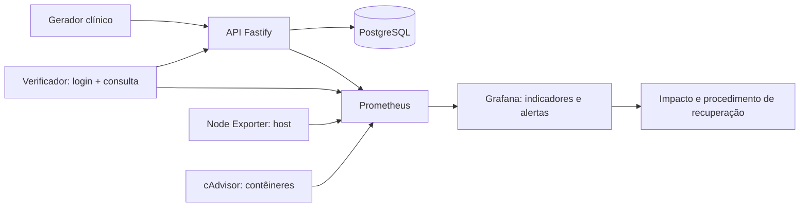

# Arquitetura da Sprint 1

As setas para Prometheus representam o fluxo dos dados; a coleta é iniciada pelo Prometheus. Gerador e verificador compartilham um serviço TypeScript, mas usam identidades diferentes. O gerador reutiliza token por até 14 minutos; o verificador autentica em cada coleta e valida o prontuário 1. Uma falha desse fluxo retorna `probe_success=0` com HTTP 200 no endpoint de métricas; uma falha do coletor resulta em `up=0` ou alvo ausente.

## Fronteiras e persistência

Sete serviços, sem serviços gerenciados externos. API usa apenas SELECT no banco; a credencial de inicialização pertence ao PostgreSQL. O perfil clínico permite leitura de todos os registros fictícios. Não é um modelo de autorização de prontuário para produção.

As redes `backend` e `monitoring` são internas. A rede bridge `access` conecta somente API e Grafana, permitindo publicar suas portas exclusivamente em 127.0.0.1. Esses dois serviços podem realizar conexões de saída; o gerador, banco e coletores não participam dessa rede. A publicação local foi validada no Docker 29 com cgroups v2.

Volumes separados preservam PostgreSQL, Prometheus e Grafana. Prometheus retém até sete dias, limitado também a 2 GB: em caso de atingir o limite de tamanho, o histórico mais antigo será removido antes. Logs têm rotação de 3 × 10 MB por serviço. Dados observados pertencem a sessões reais, com lacunas preservadas.

Os limites somam 5,75 CPUs e 7 GiB. Node Exporter observa todo o host; recursos de outros projetos podem aparecer nas métricas da máquina. Na coleta do cAdvisor, Prometheus mantém apenas amostras com `com.docker.compose.project=governanca-saude`; os gráficos também aplicam esse filtro. A métrica `up` do coletor continua sendo produzida pelo próprio Prometheus.

O cAdvisor acessa os sockets locais Docker e containerd. Instalações novas do [Docker 29 usam o armazenamento containerd](https://docs.docker.com/engine/storage/containerd/); nessa configuração, o [cAdvisor 0.60.5 consulta a API containerd](https://github.com/google/cadvisor/blob/v0.60.5/container/docker/factory.go) para identificar os contêineres Docker. A montagem fica restrita a esse coletor e não publica portas adicionais. `npm start` exige tanto coleta de 100% quanto métricas dos sete serviços para declarar prontidão.

## Implantação futura em VM

1. Criar VM Linux isolada, com Docker convencional, ao menos 6 vCPUs e 8 GiB disponíveis para o laboratório e espaço para sistema/imagens/volumes. Validar consumo real antes de escolher tamanho definitivo.
2. Permitir SSH apenas da origem administrativa; usar chave SSH, usuário dedicado e desabilitar login por senha conforme política do ambiente. Acesso ao Docker concede controle elevado do host: restringir a operadores do laboratório.
3. Em Ubuntu 24.04 ou Ubuntu >=26, clonar o repositório, executar `./bootstrap.sh` para Node/npm, `npm run setup` para preparar os requisitos e `npm start` para subir o laboratório. Não transferir credenciais por repositório, relatório ou chat. O setup requer ao menos 15 GiB livres nos discos do projeto e dos dados Docker, 6 CPUs e 8 GiB de RAM; futuras versões do Ubuntu dependem dos pacotes disponibilizados pelo Docker.
4. Executar `npm run test:integration` com o laboratório ativo. Nenhuma porta de banco, métrica ou Grafana precisa ser pública.
5. Acessar por `ssh -L 3001:127.0.0.1:3001 -L 3000:127.0.0.1:3000 usuario@vm`. O link do procedimento depende também do encaminhamento da porta 3000.

Não há provisionamento de nuvem nesta entrega. Acesso público exigiria uma decisão posterior de publicação, TLS e autenticação apropriada. Um único host e um único Prometheus não oferecem alta disponibilidade nem observação externa da perda total do laboratório.
