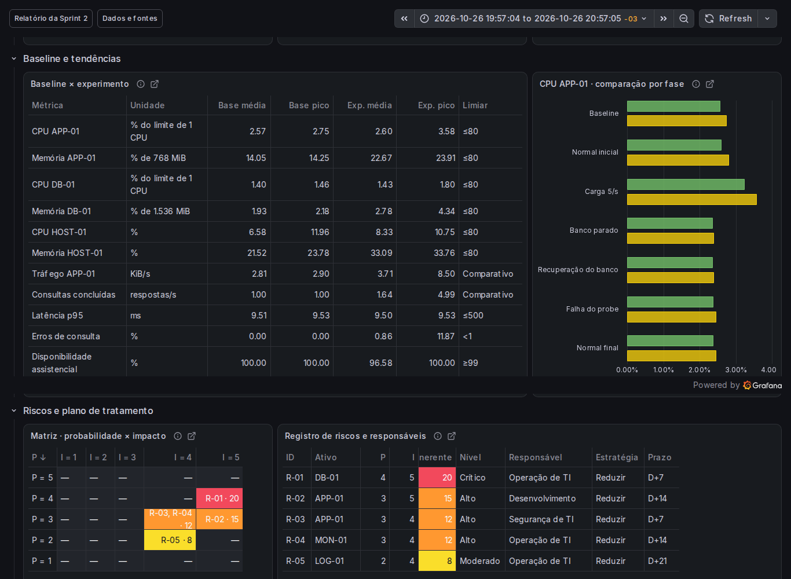
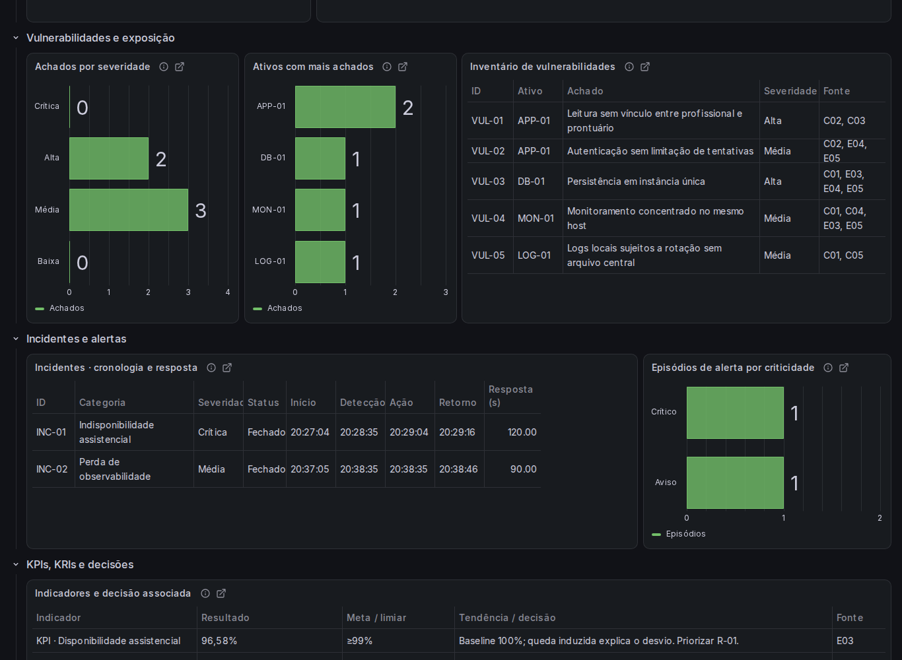
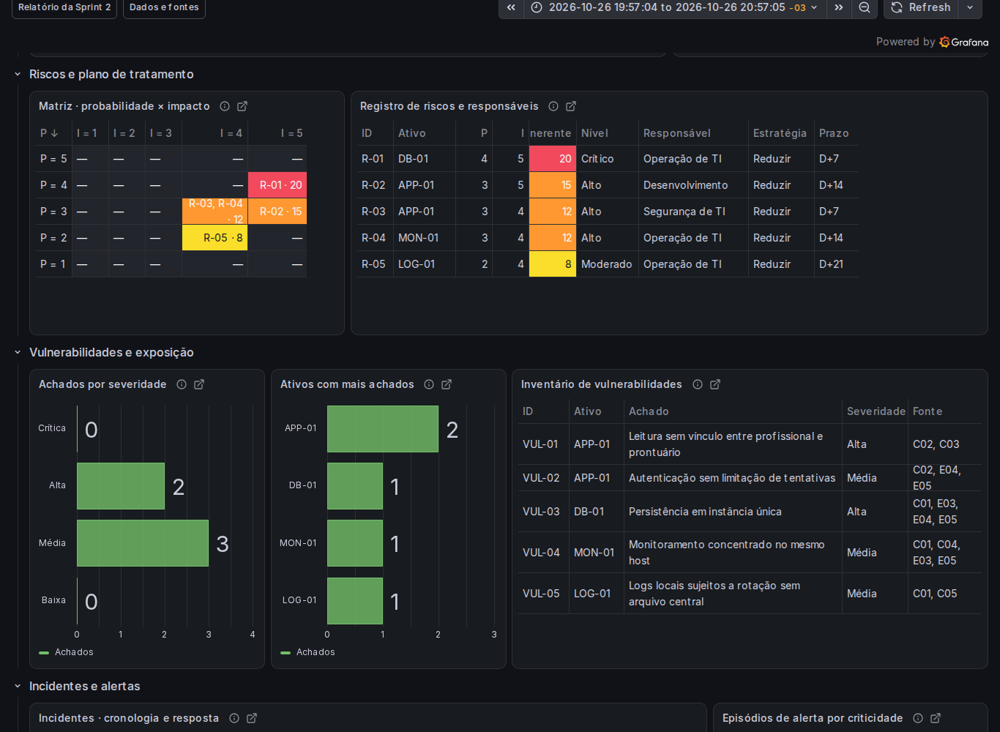
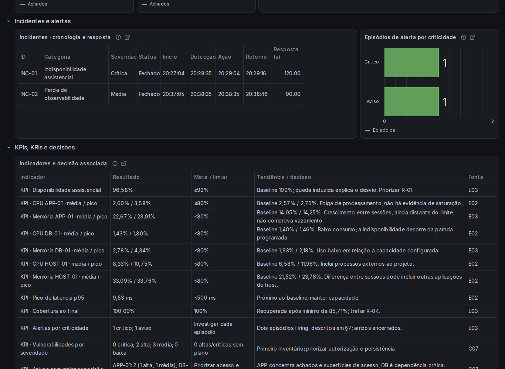
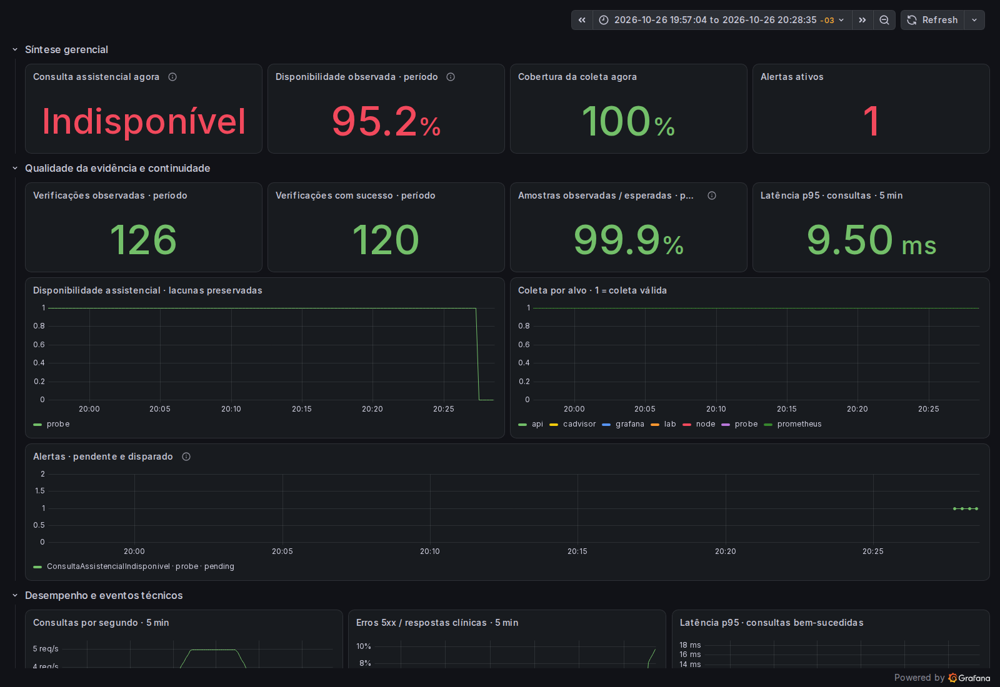
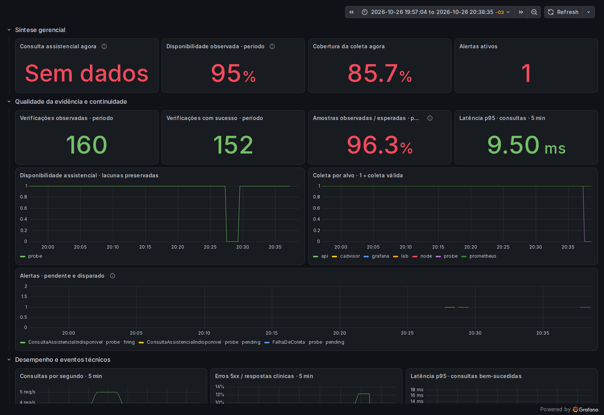

# Modelo 03 — Relatório da Sprint 2 | Analisar

## 1. Resumo da sprint

A análise identificou capacidade disponível sob carga de até cinco consultas/s e duas interrupções distintas: indisponibilidade assistencial causada pela parada do banco e perda de observabilidade causada pela falha do probe. Ambos os incidentes foram encerrados. A disponibilidade observada foi 96,58%, com 8 verificações malsucedidas em 234. O principal fator de continuidade é a dependência do banco, não a saturação de CPU ou memória. [E02](../analysis/sprint2/sources/E02.txt) [E03](../analysis/sprint2/sources/E03.txt) [E04](../analysis/sprint2/sources/E04.txt) [E05](../analysis/sprint2/sources/E05.txt)

Foram registrados cinco achados de configuração/arquitetura e cinco riscos inerentes: 1 crítico e 3 altos. Todos têm tratamento, responsável e prazo propostos; isso não significa que os controles já estejam implementados. As prioridades são recuperação do banco, autorização por prontuário e limitação de tentativas de login. [C01](../analysis/sprint2/sources/C01.txt) [C02](../analysis/sprint2/sources/C02.txt) [C03](../analysis/sprint2/sources/C03.txt)

Índice de atendimento às entregas obrigatórias:

| Entrega | Localização | Evidência técnica |
| --- | --- | --- |
| Baseline do ambiente | [Seção 3](#sec3) | [B02](../analysis/sprint2/sources/B02.txt) [B03](../analysis/sprint2/sources/B03.txt) · consultas Q01–Q09; [F01](#F01) |
| Disponibilidade e desempenho | [Seção 3](#sec3); [Seção 4](#sec4); [Seção 8](#sec8) | [B02](../analysis/sprint2/sources/B02.txt) [B03](../analysis/sprint2/sources/B03.txt) [E02](../analysis/sprint2/sources/E02.txt) [E03](../analysis/sprint2/sources/E03.txt) · comparação, fases e eventos |
| Inventário de vulnerabilidades | [Seção 5](#sec5) | [C01](../analysis/sprint2/sources/C01.txt) [C02](../analysis/sprint2/sources/C02.txt) [C03](../analysis/sprint2/sources/C03.txt) [C05](../analysis/sprint2/sources/C05.txt) [E04](../analysis/sprint2/sources/E04.txt) [E05](../analysis/sprint2/sources/E05.txt) · trechos e eventos por achado; [F03](#F03) |
| Registro de riscos | [Seção 6](#sec6) | [C07](../analysis/sprint2/sources/C07.txt) · R-01 a R-05 com fontes técnicas por risco |
| Matriz de probabilidade × impacto | [Seção 6](#sec6) | [C07](../analysis/sprint2/sources/C07.txt) · produto P × I e posicionamento dos riscos; [F02](#F02) |
| Plano preliminar de tratamento | [Seção 10](#sec10) | [C07](../analysis/sprint2/sources/C07.txt) · estratégia, prazo, responsável e fonte por ação |
| Cenário de incidente simulado | [Seção 7](#sec7) | [E03](../analysis/sprint2/sources/E03.txt) [E04](../analysis/sprint2/sources/E04.txt) [E05](../analysis/sprint2/sources/E05.txt) · eventos controlados, alertas e recuperação |
| Classificação de incidentes | [Seção 7](#sec7) | [E03](../analysis/sprint2/sources/E03.txt) [E05](../analysis/sprint2/sources/E05.txt) · categoria, severidade, impacto, status e tempos |
| Cálculo de KPIs e KRIs | [Seção 8](#sec8) | [B02](../analysis/sprint2/sources/B02.txt) [B03](../analysis/sprint2/sources/B03.txt) [E02](../analysis/sprint2/sources/E02.txt) [E03](../analysis/sprint2/sources/E03.txt) [E04](../analysis/sprint2/sources/E04.txt) [E05](../analysis/sprint2/sources/E05.txt) [C07](../analysis/sprint2/sources/C07.txt) · fórmulas e população |
| Dashboard v0.2 | [Seção 9](#sec9) | [F01](#F01) [F02](#F02) [F03](#F03) [F04](#F04) · visões analíticas e capturas de alertas [F05](#F05) [F06](#F06) |

## 2. Período e qualidade dos dados

| Conjunto | Início — São Paulo (UTC−03) | Fim — São Paulo (UTC−03) | Uso |
| --- | --- | --- | --- |
| Baseline | 21/10/2026 20:54:23 | 21/10/2026 21:24:25 | 30 minutos em carga normal; [B01](../analysis/sprint2/sources/B01.txt) [B02](../analysis/sprint2/sources/B02.txt) [B03](../analysis/sprint2/sources/B03.txt) |
| Experimento | 26/10/2026 19:57:04 | 26/10/2026 20:57:05 | 60 minutos após estabilização; [E01](../analysis/sprint2/sources/E01.txt) [E02](../analysis/sprint2/sources/E02.txt) [E03](../analysis/sprint2/sources/E03.txt) [E04](../analysis/sprint2/sources/E04.txt) [E05](../analysis/sprint2/sources/E05.txt) |

Fontes: Prometheus (coleta/avaliação a cada 15 s), cAdvisor, Node Exporter, logs estruturados da API e timeline do roteiro. O experimento contém 234 verificações, 226 bem-sucedidas e completude temporal de 97,47%. A lacuna planejada do probe foi de aproximadamente 90 s. A maior lacuna de recursos dos contêineres foi 129,7 s. Ausência de dados não foi preenchida. [E01](../analysis/sprint2/sources/E01.txt) [E03](../analysis/sprint2/sources/E03.txt) [E05](../analysis/sprint2/sources/E05.txt)

Limitações: cenário simulado, janela curta, host compartilhado, imagens locais reconstruídas e sessões em dias diferentes. CPU/memória do host incluem outras aplicações. Médias e picos são calculados sobre amostras disponíveis; CPU, tráfego, erros e p95 usam curvas de cinco minutos. A média dos p95 não é o p95 global. Os limiares são referências propostas para o cenário, não SLA contratual. O baseline não demonstra uma tendência histórica de longo prazo.

O verificador anterior rejeitou a sessão por exigir 60 respostas 503 exclusivamente na consulta: foram 23 na consulta e 106 na autenticação, pois a renovação do token ocorreu durante a parada. A integridade das fontes foi conferida; a coleta completa, os alertas e a recuperação sustentam esta análise. A rejeição original foi preservada e não é ocultada nem convertida em aprovação. [E01](../analysis/sprint2/sources/E01.txt) [E03](../analysis/sprint2/sources/E03.txt) [E04](../analysis/sprint2/sources/E04.txt) [C06](../analysis/sprint2/sources/C06.txt)

## 3. Baseline operacional

| Métrica | Média baseline | Pico baseline | Média experimento | Pico experimento | Limiar |
| --- | --- | --- | --- | --- | --- |
| CPU APP-01 (% do limite de 1 CPU) | 2,57 | 2,75 | 2,60 | 3,58 | ≤ 80,00 |
| Memória APP-01 (% de 768 MiB) | 14,05 | 14,25 | 22,67 | 23,91 | ≤ 80,00 |
| CPU DB-01 (% do limite de 1 CPU) | 1,40 | 1,46 | 1,43 | 1,80 | ≤ 80,00 |
| Memória DB-01 (% de 1.536 MiB) | 1,93 | 2,18 | 2,78 | 4,34 | ≤ 80,00 |
| CPU HOST-01 (%) | 6,58 | 11,96 | 8,33 | 10,75 | ≤ 80,00 |
| Memória HOST-01 (%) | 21,52 | 23,78 | 33,09 | 33,76 | ≤ 80,00 |
| Tráfego APP-01 (KiB/s) | 2,81 | 2,90 | 3,71 | 8,50 | Referência comparativa |
| Consultas concluídas (respostas/s) | 1,00 | 1,00 | 1,64 | 4,99 | Referência comparativa |
| Latência p95 (ms) | 9,51 | 9,53 | 9,50 | 9,53 | ≤ 500,00 |
| Erros de consulta (%) | 0,00 | 0,00 | 0,86 | 11,87 | < 1,00 |
| Disponibilidade assistencial (%) | 100,00 | 100,00 | 96,58 | 100,00 | ≥ 99,00 |

Fontes das linhas: [B02](../analysis/sprint2/sources/B02.txt) [B03](../analysis/sprint2/sources/B03.txt) [E02](../analysis/sprint2/sources/E02.txt) [E03](../analysis/sprint2/sources/E03.txt). APP-01 = API (1 CPU, 768 MiB); DB-01 = PostgreSQL (1 CPU, 1.536 MiB); HOST-01 = máquina anfitriã. MON-01 reúne Prometheus/probe; LOG-01 representa a retenção local de logs. CPU e memória dos serviços usam os limites do contêiner como denominador. Tráfego soma recepção e transmissão. [C01](../analysis/sprint2/sources/C01.txt)

Disponibilidade funcional = 100 × verificações de login e consulta bem-sucedidas / verificações observadas. O fluxo mede conjuntamente API e dependência do PostgreSQL. Não há medição funcional independente de cada serviço neste recorte. up mede sucesso do scrape de métricas: a API continuou expondo métricas durante a parada do banco. Lacunas do probe reduzem a cobertura e não entram como sucesso. [B03](../analysis/sprint2/sources/B03.txt) · /queries/probe_history; [E03](../analysis/sprint2/sources/E03.txt) · /queries/probe_history, /queries/targets e /queries/coverage.

Justificativas dos limiares adotados:

| Indicador / classificação | Referência proposta | Justificativa e base |
| --- | --- | --- |
| CPU e memória | ≤80% dos limites | Preservar 20% de margem de capacidade; critério preventivo, sem saturação demonstrada. Limites em [C01](../analysis/sprint2/sources/C01.txt); consumo em [B02](../analysis/sprint2/sources/B02.txt) [B03](../analysis/sprint2/sources/B03.txt) [E02](../analysis/sprint2/sources/E02.txt) [E03](../analysis/sprint2/sources/E03.txt). |
| Disponibilidade; p95; erros | ≥99%; ≤500 ms; <1% | Referências de continuidade e desempenho do projeto para o fluxo clínico. p95 só inclui respostas 200; deve ser lido com disponibilidade e erros, pois não mede tentativas malsucedidas. [E02](../analysis/sprint2/sources/E02.txt) · /queries/clinical_p95 e /queries/clinical_errors_percent; [C02](../analysis/sprint2/sources/C02.txt) · onResponse. |
| Detecção e recuperação | MTTD ≤120 s; MTTR após detecção ≤60 s | Metas preliminares do exercício. Alerta exige 1 min de condição, com scrape/avaliação de 15 s; 120 s comporta essa espera e a resolução da coleta. Os 60 s são objetivo de recuperação automatizada, não SLA. [C04](../analysis/sprint2/sources/C04.txt); [E03](../analysis/sprint2/sources/E03.txt) [E05](../analysis/sprint2/sources/E05.txt). |
| Falhas de autenticação | Investigar ≥5/min | Proposta de sinalização de repetição, motivada pelas dez recusas controladas; não indica invasão confirmada. [E04](../analysis/sprint2/sources/E04.txt) [E05](../analysis/sprint2/sources/E05.txt); regra ainda não implementada. |
| Risco inerente | P × I; baixo 1–4, moderado 5–9, alto 10–16, crítico 17–25 | Escala qualitativa de cinco níveis, com maior prioridade para continuidade e confidencialidade. Não deriva probabilidade estatística de falhas induzidas. [C07](../analysis/sprint2/sources/C07.txt); justificativas individuais em [Seção 6](#sec6). |
| Severidade dos achados/incidentes | Alta/crítica para acesso clínico e continuidade; média para controles auxiliares | Considera impacto potencial, acesso necessário e dependência operacional. Exposição local limita alcance; perda do probe compromete observação, sem demonstrar nova queda clínica. Fontes e justificativas em [Seção 5](#sec5) e [Seção 7](#sec7). |
| Tráfego, volume, contagens e tratamento | Comparação com baseline; zero incidentes abertos; 100% com plano | Não há capacidade de rede definida. Contagens não têm série histórica anterior. Meta de tratamento significa ação, estratégia, responsável e prazo preenchidos, sem significar mitigação. [B02](../analysis/sprint2/sources/B02.txt) [E02](../analysis/sprint2/sources/E02.txt) [C07](../analysis/sprint2/sources/C07.txt). |

Consultas exatas preservadas; os range selectors das séries originais incluem o contexto de coleta descrito no manifesto. O cálculo usa apenas data.result no intervalo da seção 2, sem context_data. Médias são aritméticas e picos são máximos das amostras disponíveis; CPU dos serviços é convertida de núcleos para % do limite e memória de bytes para % do limite; rede de bytes/s para KiB/s; latência de segundos para ms. [C01](../analysis/sprint2/sources/C01.txt) [B01](../analysis/sprint2/sources/B01.txt) [E01](../analysis/sprint2/sources/E01.txt)

| Consulta / métrica | Recorte | PromQL | Fonte / localização |
| --- | --- | --- | --- |
| Q01 · CPU dos serviços | Baseline e experimento | sum by(container_label_com_docker_compose_service)(rate(container_cpu_usage_seconds_total{container_label_com_docker_compose_project="governanca-saude",container_label_com_docker_compose_service!=""}[5m])) | [B02](../analysis/sprint2/sources/B02.txt) [E02](../analysis/sprint2/sources/E02.txt) · /queries/container_cpu_cores |
| Q02 · Memória dos serviços | Baseline | container_memory_working_set_bytes{container_label_com_docker_compose_project="governanca-saude",container_label_com_docker_compose_service!=""}[2116165ms] | [B03](../analysis/sprint2/sources/B03.txt) · /queries/container_memory |
| Q02 · Memória dos serviços | Experimento | container_memory_working_set_bytes{container_label_com_docker_compose_project="governanca-saude",container_label_com_docker_compose_service!=""}[3916118ms] | [E03](../analysis/sprint2/sources/E03.txt) · /queries/container_memory |
| Q03 · Tráfego dos serviços | Baseline e experimento | sum by(container_label_com_docker_compose_service)(rate(container_network_receive_bytes_total{container_label_com_docker_compose_project="governanca-saude",container_label_com_docker_compose_service!=""}[5m]) + rate(container_network_transmit_bytes_total{container_label_com_docker_compose_project="governanca-saude",container_label_com_docker_compose_service!=""}[5m])) | [B02](../analysis/sprint2/sources/B02.txt) [E02](../analysis/sprint2/sources/E02.txt) · /queries/container_network_bytes_per_second |
| Q04 · Latência p95 | Baseline e experimento | histogram_quantile(0.95, sum by(le)(rate(clinical_request_duration_seconds_bucket{route="/prontuarios/:id",traffic="clinical"}[5m]))) and on() (sum(rate(clinical_request_duration_seconds_count{route="/prontuarios/:id",traffic="clinical"}[5m])) > 0) | [B02](../analysis/sprint2/sources/B02.txt) [E02](../analysis/sprint2/sources/E02.txt) · /queries/clinical_p95 |
| Q05 · Disponibilidade funcional | Baseline | probe_success{job="probe"}[2116165ms] | [B03](../analysis/sprint2/sources/B03.txt) · /queries/probe_history |
| Q05 · Disponibilidade funcional | Experimento | probe_success{job="probe"}[3916118ms] | [E03](../analysis/sprint2/sources/E03.txt) · /queries/probe_history |
| Q06 · CPU do host | Baseline e experimento | 100 * (1 - avg(rate(node_cpu_seconds_total{mode="idle"}[5m]))) | [B02](../analysis/sprint2/sources/B02.txt) [E02](../analysis/sprint2/sources/E02.txt) · /queries/host_cpu_percent |
| Q07 · Memória do host | Baseline e experimento | 100 * (1 - node_memory_MemAvailable_bytes / node_memory_MemTotal_bytes) | [B02](../analysis/sprint2/sources/B02.txt) [E02](../analysis/sprint2/sources/E02.txt) · /queries/host_memory_percent |
| Q08 · Volume clínico | Baseline e experimento | sum(rate(clinical_requests_total{route="/prontuarios/:id",traffic="clinical"}[5m])) | [B02](../analysis/sprint2/sources/B02.txt) [E02](../analysis/sprint2/sources/E02.txt) · /queries/clinical_volume |
| Q09 · Erros clínicos | Baseline e experimento | 100 * sum(rate(clinical_requests_total{route="/prontuarios/:id",traffic="clinical",status=~"5.."}[5m])) / (sum(rate(clinical_requests_total{route="/prontuarios/:id",traffic="clinical"}[5m])) > 0) | [B02](../analysis/sprint2/sources/B02.txt) [E02](../analysis/sprint2/sources/E02.txt) · /queries/clinical_errors_percent |
| Q10 · Coleta por alvo | Baseline | up[2116165ms] | [B03](../analysis/sprint2/sources/B03.txt) · /queries/targets |
| Q10 · Coleta por alvo | Experimento | up[3916118ms] | [E03](../analysis/sprint2/sources/E03.txt) · /queries/targets |
| Q11 · Alertas | Baseline | ALERTS[2116165ms] | [B03](../analysis/sprint2/sources/B03.txt) · /queries/alert_history |
| Q11 · Alertas | Experimento | ALERTS[3916118ms] | [E03](../analysis/sprint2/sources/E03.txt) · /queries/alert_history |

F01 · Baseline e tendências · captura de 27/10/2026 19:36:05 (UTC−03).

## 4. Anomalias e causas prováveis

| Horário em 26/10 | Evidência | Impacto / hipótese | Ação recomendada |
| --- | --- | --- | --- |
| 20:07–20:17 | Carga de 5/s; pico CPU APP-01 3,58%; p95 máximo 9,50 ms na fase de carga. [E02](../analysis/sprint2/sources/E02.txt) · /queries/container_cpu_cores e /queries/clinical_p95; [E05](../analysis/sprint2/sources/E05.txt) · load_5rps_started/finished | Aumento de demanda sem saturação observada. | Manter capacidade e acompanhar crescimento; não ampliar recursos só por este ensaio. |
| 20:22 | Dez logins recusados com HTTP 401. [E04](../analysis/sprint2/sources/E04.txt) [E05](../analysis/sprint2/sources/E05.txt) | Tentativas controladas; nenhum acesso indevido comprovado. | Aplicar limitação e alerta por repetição (R-03). |
| 20:27–20:29 | Banco parado; 23 consultas e 106 autenticações com HTTP 503. [E03](../analysis/sprint2/sources/E03.txt) [E04](../analysis/sprint2/sources/E04.txt) [E05](../analysis/sprint2/sources/E05.txt) | Dependência do banco interrompe o fluxo; renovação de token muda a etapa da falha. | Priorizar recuperação e backup (R-01). |
| 20:37–20:38 | Probe sem coleta; API e gerador continuam. [E03](../analysis/sprint2/sources/E03.txt) [E05](../analysis/sprint2/sources/E05.txt) | Perda de visibilidade, sem indisponibilidade clínica demonstrada nesse intervalo. | Adicionar observação externa (R-04). |
| Comparação entre sessões | Memória média APP-01: 14,05% → 22,67%. [B03](../analysis/sprint2/sources/B03.txt) [E03](../analysis/sprint2/sources/E03.txt) | Maior working set com outra sessão/imagem/carga; dados não provam vazamento. | Acompanhar séries mais longas antes de atribuir causa ou alterar limites. |

## 5. Vulnerabilidades

Inventário obtido por revisão de código, configuração e evidências do cenário. São fragilidades de controle e arquitetura; não se trata de uma lista de CVEs confirmadas por scanner. A exposição atual é local, com API e Grafana vinculados a loopback. As severidades representam impacto potencial no cenário de saúde.

| ID | Ativo | Achado | Severidade | Exposição | Tratamento / evidência |
| --- | --- | --- | --- | --- | --- |
| VUL-01 | APP-01 | Leitura sem vínculo entre profissional e prontuário | Alta | Usuário autenticado pode consultar qualquer ID válido; acesso restrito ao ambiente local. | Aplicar autorização por vínculo profissional–paciente e testar acesso cruzado. [C02](../analysis/sprint2/sources/C02.txt) [C03](../analysis/sprint2/sources/C03.txt) |
| VUL-02 | APP-01 | Autenticação sem limitação de tentativas | Média | Endpoint local de login; dez tentativas consecutivas foram processadas e recusadas, sem bloqueio progressivo. | Limitar tentativas por origem/identidade e criar alerta por janela curta. [C02](../analysis/sprint2/sources/C02.txt) [E04](../analysis/sprint2/sources/E04.txt) [E05](../analysis/sprint2/sources/E05.txt) |
| VUL-03 | DB-01 | Persistência em instância única | Alta | A indisponibilidade do PostgreSQL interrompe autenticação e consultas. | Definir recuperação, cópias de segurança e ensaio de restauração; avaliar réplica conforme criticidade. [C01](../analysis/sprint2/sources/C01.txt) [E03](../analysis/sprint2/sources/E03.txt) [E04](../analysis/sprint2/sources/E04.txt) [E05](../analysis/sprint2/sources/E05.txt) |
| VUL-04 | MON-01 | Monitoramento concentrado no mesmo host | Média | Perda do host também elimina a observação local; a falha do probe demonstrou perda parcial de visibilidade. | Adicionar verificação externa e notificação de ausência de coleta. [C01](../analysis/sprint2/sources/C01.txt) [C04](../analysis/sprint2/sources/C04.txt) [E03](../analysis/sprint2/sources/E03.txt) [E05](../analysis/sprint2/sources/E05.txt) |
| VUL-05 | LOG-01 | Logs locais sujeitos a rotação sem arquivo central | Média | Histórico pode ser perdido por rotação ou falha do host, reduzindo a capacidade de investigação. | Definir retenção e exportação periódica; centralizar logs na Sprint 3. [C01](../analysis/sprint2/sources/C01.txt) [C05](../analysis/sprint2/sources/C05.txt) |

| Achado | Conclusão da revisão | Trecho ou evento técnico |
| --- | --- | --- |
| VUL-01 | O handler valida o token, mas a consulta SQL recebe apenas o ID do prontuário. | [C02](../analysis/sprint2/sources/C02.txt) · linhas 89–90: «await request.jwtVerify(); if (!['clinical', 'probe'].includes(request.user.kind) \|\| !request.user.sub) throw new Error('Invalid principal');»; [C02](../analysis/sprint2/sources/C02.txt) · linhas 98–98: «const record = await repository.record(request.params.id);»; [C03](../analysis/sprint2/sources/C03.txt) · linhas 23–23: «return (await pool.query<RecordData>('SELECT id, paciente, resumo FROM prontuarios WHERE id = $1', [id])).rows[0];» |
| VUL-02 | Não há rate limiting no fluxo de autenticação; o cenário registrou dez respostas 401. | [C02](../analysis/sprint2/sources/C02.txt) · linhas 68–68: «app.post<{ Body: { username: string; password: string } }>('/auth/login', {»; [C02](../analysis/sprint2/sources/C02.txt) · linhas 75–78: «if (!professional \|\| !valid) { authFailures.labels('login').inc(); return reply.code(401).send({ error: 'invalid_credentials' }); }»; [E04](../analysis/sprint2/sources/E04.txt) · event=authentication; status=401 (respostas únicas): «10 tentativas recusadas»; [E05](../analysis/sprint2/sources/E05.txt) · /6 · event=ten_invalid_logins_completed: «2026-10-26T23:22:05.315123+00:00 · ten_invalid_logins_completed» |
| VUL-03 | O Compose possui uma instância do banco; o cenário confirmou a dependência do fluxo assistencial. | [C01](../analysis/sprint2/sources/C01.txt) · linhas 14–16: «postgres: <<: *common image: postgres:17.6-bookworm»; [E05](../analysis/sprint2/sources/E05.txt) · /8 · event=postgres_outage_confirmed: «2026-10-26T23:27:04.964592+00:00 · postgres_outage_confirmed»; [E04](../analysis/sprint2/sources/E04.txt) · status=503; event=record_access (traffic=clinical) ou authentication: «23 consultas e 106 autenticações indisponíveis» |
| VUL-04 | Prometheus, Grafana e verificador compartilham o host; a coleta ficou em 6 de 7 alvos no cenário isolado. | [C01](../analysis/sprint2/sources/C01.txt) · linhas 77–79: «prometheus: <<: *common image: prom/prometheus:v3.14.0»; [C01](../analysis/sprint2/sources/C01.txt) · linhas 93–95: «grafana: <<: *common image: grafana/grafana:13.2.1»; [E03](../analysis/sprint2/sources/E03.txt) · /queries/targets · job=probe: «6 amostras up=0; cobertura mínima 85,71%»; [E05](../analysis/sprint2/sources/E05.txt) · /13 · event=probe_outage_confirmed: «2026-10-26T23:37:05.016169+00:00 · probe_outage_confirmed» |
| VUL-05 | Configuração json-file com 10 MB por arquivo e três arquivos por serviço; nenhuma fonte central configurada. | [C01](../analysis/sprint2/sources/C01.txt) · linhas 4–7: «driver: json-file options: max-size: "10m" max-file: "3"»; [C05](../analysis/sprint2/sources/C05.txt) · linhas 13–13: «Os logs continuam locais nesta etapa.» |

Ativos com maior exposição: APP-01 concentra dois achados (um alto e um médio) nas superfícies de consulta autenticada e login; DB-01 tem um achado alto e é a dependência que interrompeu o fluxo clínico. MON-01 e LOG-01 têm um achado médio cada, ligados à detecção e investigação. Esta priorização combina severidade, condições de acesso e dependência; quantidade de achados sozinha não mede exposição, e não foi criada pontuação adicional. [C01](../analysis/sprint2/sources/C01.txt) [C02](../analysis/sprint2/sources/C02.txt) [C03](../analysis/sprint2/sources/C03.txt) [C05](../analysis/sprint2/sources/C05.txt) [E03](../analysis/sprint2/sources/E03.txt) [E04](../analysis/sprint2/sources/E04.txt) [E05](../analysis/sprint2/sources/E05.txt) [C07](../analysis/sprint2/sources/C07.txt)

| Ativo | Achados por severidade | Condição de exposição e dependência | Fontes |
| --- | --- | --- | --- |
| APP-01 | 1 alta; 1 média · VUL-01, VUL-02 | Usuário autenticado pode consultar qualquer ID válido; acesso restrito ao ambiente local. Endpoint local de login; dez tentativas consecutivas foram processadas e recusadas, sem bloqueio progressivo. | [C02](../analysis/sprint2/sources/C02.txt) [C03](../analysis/sprint2/sources/C03.txt) [E04](../analysis/sprint2/sources/E04.txt) [E05](../analysis/sprint2/sources/E05.txt) |
| DB-01 | 1 alta · VUL-03 | A indisponibilidade do PostgreSQL interrompe autenticação e consultas. | [C01](../analysis/sprint2/sources/C01.txt) [E03](../analysis/sprint2/sources/E03.txt) [E04](../analysis/sprint2/sources/E04.txt) [E05](../analysis/sprint2/sources/E05.txt) |
| MON-01 | 1 média · VUL-04 | Perda do host também elimina a observação local; a falha do probe demonstrou perda parcial de visibilidade. | [C01](../analysis/sprint2/sources/C01.txt) [C04](../analysis/sprint2/sources/C04.txt) [E03](../analysis/sprint2/sources/E03.txt) [E05](../analysis/sprint2/sources/E05.txt) |
| LOG-01 | 1 média · VUL-05 | Histórico pode ser perdido por rotação ou falha do host, reduzindo a capacidade de investigação. | [C01](../analysis/sprint2/sources/C01.txt) [C05](../analysis/sprint2/sources/C05.txt) |

F03 · Inventário de vulnerabilidades · captura de 27/10/2026 19:36:05 (UTC−03).

## 6. Registro e matriz de riscos

Avaliação qualitativa do cenário: probabilidade e impacto de 1 a 5; risco inerente = P × I. Baixo 1–4, moderado 5–9, alto 10–16, crítico 17–25. Prioridades e prazos são propostas de tratamento, não controles já implementados. A probabilidade é uma avaliação qualitativa do cenário, não a frequência das falhas induzidas. Impacto considera continuidade, confidencialidade e capacidade de investigação. Responsáveis são papéis organizacionais propostos.

| ID | Ativo/processo | Ameaça | Vulnerabilidade | Prob. | Impacto | Risco inerente | Responsável |
| --- | --- | --- | --- | --- | --- | --- | --- |
| R-01 | DB-01 / atendimento | Falha da dependência de dados | VUL-03 | 4 | 5 | 20 · Crítico | Operação de TI |
| R-02 | APP-01 / acesso clínico | Uso indevido de credencial válida | VUL-01 | 3 | 5 | 15 · Alto | Desenvolvimento |
| R-03 | APP-01 / autenticação | Tentativas repetidas de adivinhação de senha | VUL-02 | 3 | 4 | 12 · Alto | Segurança de TI |
| R-04 | MON-01 / detecção | Perda do coletor ou do host monitorado | VUL-04 | 3 | 4 | 12 · Alto | Operação de TI |
| R-05 | LOG-01 / investigação | Perda de registros operacionais | VUL-05 | 2 | 4 | 8 · Moderado | Operação de TI |

| Probabilidade ↓ / Impacto → | 1 | 2 | 3 | 4 | 5 |
| --- | --- | --- | --- | --- | --- |
| 5 · Quase certo | — | — | — | — | — |
| 4 · Provável | — | — | — | — | R-01 |
| 3 · Possível | — | — | — | R-03; R-04 | R-02 |
| 2 · Pouco provável | — | — | — | R-05 | — |
| 1 · Raro | — | — | — | — | — |

| Risco | Causa → evento → impacto | Justificativa / fonte |
| --- | --- | --- |
| R-01 | Instância única de persistência → Autenticação e consulta indisponíveis → Interrupção do atendimento e atraso na consulta de registros | A dependência foi demonstrada no incidente; P=4 representa o cenário proposto, não uma frequência estatística. [E03](../analysis/sprint2/sources/E03.txt) [E04](../analysis/sprint2/sources/E04.txt) [E05](../analysis/sprint2/sources/E05.txt) [C01](../analysis/sprint2/sources/C01.txt) |
| R-02 | Ausência de autorização por prontuário → Leitura fora da necessidade de acesso → Exposição indevida de informações clínicas | O acesso exige autenticação, mas não há verificação do vínculo com o registro; impacto potencial elevado. [C02](../analysis/sprint2/sources/C02.txt) [C03](../analysis/sprint2/sources/C03.txt) |
| R-03 | Ausência de contenção progressiva de tentativas → Comprometimento de conta ou pressão sobre o login → Acesso indevido ou degradação do serviço | O cenário comprovou repetição de tentativas recusadas; não comprovou comprometimento. Exposição atual é local. [C02](../analysis/sprint2/sources/C02.txt) [E04](../analysis/sprint2/sources/E04.txt) [E05](../analysis/sprint2/sources/E05.txt) |
| R-04 | Dependência de observação local → Atraso na identificação de indisponibilidade → Maior duração do impacto por ausência de diagnóstico | A perda do probe foi observada; a perda total do host é uma hipótese de risco baseada na arquitetura. [C01](../analysis/sprint2/sources/C01.txt) [C04](../analysis/sprint2/sources/C04.txt) [E03](../analysis/sprint2/sources/E03.txt) [E05](../analysis/sprint2/sources/E05.txt) |
| R-05 | Retenção local limitada e ausência de arquivo externo → Evidências insuficientes para reconstruir um incidente → Atraso na investigação e tratamento inadequado | Não houve perda comprovada nesta sessão; o risco decorre da política de rotação e do armazenamento local. [C01](../analysis/sprint2/sources/C01.txt) [C05](../analysis/sprint2/sources/C05.txt) |

| Risco | Sustentação técnica | Tratamento preliminar associado |
| --- | --- | --- |
| R-01 | [C01](../analysis/sprint2/sources/C01.txt) · linhas 14–16: «postgres: <<: *common image: postgres:17.6-bookworm»; [E05](../analysis/sprint2/sources/E05.txt) · /8 · event=postgres_outage_confirmed: «2026-10-26T23:27:04.964592+00:00 · postgres_outage_confirmed»; [E04](../analysis/sprint2/sources/E04.txt) · status=503; event=record_access (traffic=clinical) ou authentication: «23 consultas e 106 autenticações indisponíveis» | Reduzir · Formalizar recuperação e executar teste de restauração de backup. · Operação de TI · D+7 · Planejado |
| R-02 | [C02](../analysis/sprint2/sources/C02.txt) · linhas 89–90: «await request.jwtVerify(); if (!['clinical', 'probe'].includes(request.user.kind) \|\| !request.user.sub) throw new Error('Invalid principal');»; [C02](../analysis/sprint2/sources/C02.txt) · linhas 98–98: «const record = await repository.record(request.params.id);»; [C03](../analysis/sprint2/sources/C03.txt) · linhas 23–23: «return (await pool.query<RecordData>('SELECT id, paciente, resumo FROM prontuarios WHERE id = $1', [id])).rows[0];» | Reduzir · Implementar autorização por vínculo e testes negativos de acesso cruzado. · Desenvolvimento · D+14 · Planejado |
| R-03 | [C02](../analysis/sprint2/sources/C02.txt) · linhas 68–68: «app.post<{ Body: { username: string; password: string } }>('/auth/login', {»; [C02](../analysis/sprint2/sources/C02.txt) · linhas 75–78: «if (!professional \|\| !valid) { authFailures.labels('login').inc(); return reply.code(401).send({ error: 'invalid_credentials' }); }»; [E04](../analysis/sprint2/sources/E04.txt) · event=authentication; status=401 (respostas únicas): «10 tentativas recusadas»; [E05](../analysis/sprint2/sources/E05.txt) · /6 · event=ten_invalid_logins_completed: «2026-10-26T23:22:05.315123+00:00 · ten_invalid_logins_completed» | Reduzir · Aplicar rate limiting e alerta para cinco ou mais falhas em um minuto. · Segurança de TI · D+7 · Planejado |
| R-04 | [C01](../analysis/sprint2/sources/C01.txt) · linhas 77–79: «prometheus: <<: *common image: prom/prometheus:v3.14.0»; [C01](../analysis/sprint2/sources/C01.txt) · linhas 93–95: «grafana: <<: *common image: grafana/grafana:13.2.1»; [E03](../analysis/sprint2/sources/E03.txt) · /queries/targets · job=probe: «6 amostras up=0; cobertura mínima 85,71%»; [E05](../analysis/sprint2/sources/E05.txt) · /13 · event=probe_outage_confirmed: «2026-10-26T23:37:05.016169+00:00 · probe_outage_confirmed» | Reduzir · Adicionar verificação externa e canal de notificação. · Operação de TI · D+14 · Planejado |
| R-05 | [C01](../analysis/sprint2/sources/C01.txt) · linhas 4–7: «driver: json-file options: max-size: "10m" max-file: "3"»; [C05](../analysis/sprint2/sources/C05.txt) · linhas 13–13: «Os logs continuam locais nesta etapa.» | Reduzir · Automatizar exportação e definir retenção; integrar centralização na Sprint 3. · Operação de TI · D+21 · Planejado |

Escalas qualitativas: P=1: Raro; P=2: Pouco provável; P=3: Possível; P=4: Provável; P=5: Quase certo. Impacto: I=1: Insignificante; I=2: Pequeno; I=3: Moderado; I=4: Grave; I=5: Muito grave. P considera acesso necessário, controles e dependência; I considera interrupção clínica, acesso indevido e perda de capacidade de investigação. As notas são julgamentos documentados em [C07](../analysis/sprint2/sources/C07.txt), apoiados nas fontes acima; não são métricas coletadas. R-01 tem I=5 pela parada assistencial; R-02, pela exposição potencial de registros; R-03/R-04/R-05 têm I=4 pelos efeitos potenciais de acesso, detecção ou investigação. Reduzir foi escolhido para manter o serviço e acrescentar controles; não há proposta de transferência ou aceitação sem controle nesta avaliação.

F02 · Matriz e registro de riscos · captura de 27/10/2026 19:36:05 (UTC−03).

## 7. Incidente simulado

Cenário principal: parada controlada do PostgreSQL por 120 s, interrompendo autenticação e consulta. Severidade crítica pela indisponibilidade do fluxo assistencial. Contenção: manter o teste restrito ao ambiente local e observar a API/coleta. Recuperação: reiniciar a dependência e confirmar login e leitura. O segundo incidente interrompeu somente o probe por 90 s; a restauração ocorreu por expiração/controle local. As respostas foram automatizadas pelo roteiro, não medem tempo de reação humana. [E03](../analysis/sprint2/sources/E03.txt) [E04](../analysis/sprint2/sources/E04.txt) [E05](../analysis/sprint2/sources/E05.txt)

| Incidente / categoria | Severidade / status | Início confirmado | Detecção | Recuperação observada | Responsável |
| --- | --- | --- | --- | --- | --- |
| INC-01 · Indisponibilidade assistencial | Crítica / Fechado | 26/10/2026 20:27:04 | 26/10/2026 20:28:35 | 26/10/2026 20:29:16 | Operação de TI |
| INC-02 · Perda de observabilidade | Média / Fechado | 26/10/2026 20:37:05 | 26/10/2026 20:38:35 | 26/10/2026 20:38:46 | Operação de TI |

| Incidente | Tempo até detectar | Início → ação automatizada | Recuperação após detecção | Duração do impacto | Evidência |
| --- | --- | --- | --- | --- | --- |
| INC-01 | 90,78 s | 120,00 s | 41,04 s | 131,83 s | [E03](../analysis/sprint2/sources/E03.txt) [E05](../analysis/sprint2/sources/E05.txt) |
| INC-02 | 90,73 s | 90,00 s | 11,04 s | 101,77 s | [E03](../analysis/sprint2/sources/E03.txt) [E05](../analysis/sprint2/sources/E05.txt) |

Impacto de INC-01: interrupção do fluxo clínico, com respostas 503 em consultas e autenticações. Impacto de INC-02: perda da observação do probe; sua duração mede perda de visibilidade, não indisponibilidade clínica. A contenção foi limitar a injeção à dependência selecionada e ao ambiente local, mantendo os demais serviços e revertendo a falha pelo roteiro. Categoria, severidade e status se baseiam nesses efeitos e na primeira amostra saudável; não houve medição de resposta humana. [E03](../analysis/sprint2/sources/E03.txt) [E04](../analysis/sprint2/sources/E04.txt) [E05](../analysis/sprint2/sources/E05.txt)

| Horário — São Paulo (UTC−03), com milissegundos | Incidente | Etapa | Evento / amostra |
| --- | --- | --- | --- |
| 26/10/2026 20:27:04.964 | INC-01 | Interrupção confirmada | [E05](../analysis/sprint2/sources/E05.txt) · /8 · event=postgres_outage_confirmed: «2026-10-26T23:27:04.964592+00:00 · postgres_outage_confirmed» |
| 26/10/2026 20:28:35.747 | INC-01 | Alerta em firing: ConsultaAssistencialIndisponivel | [E03](../analysis/sprint2/sources/E03.txt) · /queries/alert_history: «ConsultaAssistencialIndisponivel · primeiro firing 2026-10-26T23:28:35.747000+00:00» |
| 26/10/2026 20:29:04.966 | INC-01 | Restauração solicitada pelo roteiro | [E05](../analysis/sprint2/sources/E05.txt) · /9 · event=postgres_restart_requested: «2026-10-26T23:29:04.966495+00:00 · postgres_restart_requested» |
| 26/10/2026 20:29:16.790 | INC-01 | Recuperação observada | [E03](../analysis/sprint2/sources/E03.txt) · /queries/probe_history: «primeira amostra = 1 após restauração: 2026-10-26T23:29:16.790000+00:00» |
| 26/10/2026 20:37:05.016 | INC-02 | Interrupção confirmada | [E05](../analysis/sprint2/sources/E05.txt) · /13 · event=probe_outage_confirmed: «2026-10-26T23:37:05.016169+00:00 · probe_outage_confirmed» |
| 26/10/2026 20:38:35.018 | INC-02 | Restauração solicitada pelo roteiro | [E05](../analysis/sprint2/sources/E05.txt) · /14 · event=probe_restore_requested: «2026-10-26T23:38:35.018003+00:00 · probe_restore_requested» |
| 26/10/2026 20:38:35.747 | INC-02 | Alerta em firing: FalhaDeColeta | [E03](../analysis/sprint2/sources/E03.txt) · /queries/alert_history: «FalhaDeColeta · primeiro firing 2026-10-26T23:38:35.747000+00:00» |
| 26/10/2026 20:38:46.790 | INC-02 | Recuperação observada | [E03](../analysis/sprint2/sources/E03.txt) · /queries/targets: «primeira amostra = 1 após restauração: 2026-10-26T23:38:46.790000+00:00» |

A timeline está em ordem temporal. Em INC-02, probe_restore_requested precede a primeira amostra de firing em cerca de 0,73 s: a ação foi programada, não disparada pelo alerta. Tempo de resposta aqui significa início confirmado → solicitação de restauração, separado de detecção e recuperação. [E03](../analysis/sprint2/sources/E03.txt) [E05](../analysis/sprint2/sources/E05.txt)

Dois episódios de alerta foram identificados: um crítico e um warning. Amostras consecutivas da mesma regra e conjunto de labels, separadas por até 30 s, formam um episódio. Não se contam amostras de ALERTS como incidentes. A cronologia confirma o cenário, e a primeira amostra saudável após a solicitação de restauração define recuperação. A perda do probe é incidente de observabilidade separado do incidente assistencial.

| Regra | Criticidade | Primeira amostra firing | Última amostra firing | Evidência |
| --- | --- | --- | --- | --- |
| ConsultaAssistencialIndisponivel | critical | 26/10/2026 20:28:35.747 | 26/10/2026 20:29:20.747 | [E03](../analysis/sprint2/sources/E03.txt) · /queries/alert_history; [C04](../analysis/sprint2/sources/C04.txt); [F05](#F05) |
| FalhaDeColeta | warning | 26/10/2026 20:38:35.747 | 26/10/2026 20:38:50.747 | [E03](../analysis/sprint2/sources/E03.txt) · /queries/alert_history; [C04](../analysis/sprint2/sources/C04.txt); [F06](#F06) |

F04 · Incidentes e episódios de alerta · captura de 27/10/2026 19:36:05 (UTC−03).

F05 · Alerta de indisponibilidade assistencial em firing · captura de 26/10/2026 20:28:50 (UTC−03).

F06 · Alerta de falha de coleta em firing · captura de 26/10/2026 20:38:47 (UTC−03).

## 8. KPIs e KRIs

| Indicador | Resultado atual | Meta / limiar | Tendência / decisão e fonte |
| --- | --- | --- | --- |
| KPI · Disponibilidade assistencial | 96,58% | ≥99% | Baseline 100%; queda induzida explica o desvio. Priorizar R-01. [E03](../analysis/sprint2/sources/E03.txt) · /queries/probe_history: «226/234 verificações bem-sucedidas» |
| KPI · CPU APP-01 · média / pico | 2,60% / 3,58% | ≤80% | Baseline 2,57% / 2,75%. Folga de processamento; não há evidência de saturação. [E02](../analysis/sprint2/sources/E02.txt) · /queries/container_cpu_cores: «Média e máximo das amostras; denominador e conversões em [Seção 3](#sec3).» |
| KPI · Memória APP-01 · média / pico | 22,67% / 23,91% | ≤80% | Baseline 14,05% / 14,25%. Crescimento entre sessões, ainda distante do limite; não comprova vazamento. [E03](../analysis/sprint2/sources/E03.txt) · /queries/container_memory: «Média e máximo das amostras; denominador e conversões em [Seção 3](#sec3).» |
| KPI · CPU DB-01 · média / pico | 1,43% / 1,80% | ≤80% | Baseline 1,40% / 1,46%. Baixo consumo; a indisponibilidade decorre da parada programada. [E02](../analysis/sprint2/sources/E02.txt) · /queries/container_cpu_cores: «Média e máximo das amostras; denominador e conversões em [Seção 3](#sec3).» |
| KPI · Memória DB-01 · média / pico | 2,78% / 4,34% | ≤80% | Baseline 1,93% / 2,18%. Uso baixo em relação à capacidade configurada. [E03](../analysis/sprint2/sources/E03.txt) · /queries/container_memory: «Média e máximo das amostras; denominador e conversões em [Seção 3](#sec3).» |
| KPI · CPU HOST-01 · média / pico | 8,33% / 10,75% | ≤80% | Baseline 6,58% / 11,96%. Inclui processos externos ao projeto. [E02](../analysis/sprint2/sources/E02.txt) · /queries/host_cpu_percent: «Média e máximo das amostras; denominador e conversões em [Seção 3](#sec3).» |
| KPI · Memória HOST-01 · média / pico | 33,09% / 33,76% | ≤80% | Baseline 21,52% / 23,78%. Diferença entre sessões pode incluir outras aplicações do host. [E02](../analysis/sprint2/sources/E02.txt) · /queries/host_memory_percent: «Média e máximo das amostras; denominador e conversões em [Seção 3](#sec3).» |
| KPI · Pico de latência p95 | 9,53 ms | ≤500 ms | Próximo ao baseline; manter capacidade. [E02](../analysis/sprint2/sources/E02.txt) · /queries/clinical_p95: «Máximo da curva p95 de cinco minutos; apenas respostas 200.» |
| KPI · Cobertura ao final | 100,00% | 100% | Recuperada após mínimo de 85,71%; tratar R-04. [E03](../analysis/sprint2/sources/E03.txt) · /queries/coverage: «Última amostra e mínimo de lab:collection_coverage_percent.» |
| KPI · Alertas por criticidade | 1 crítico; 1 aviso | Investigar cada episódio | Dois episódios firing, descritos em [Seção 7](#sec7); ambos encerrados. [E03](../analysis/sprint2/sources/E03.txt) · /queries/alert_history: «Agrupamento por labels, lacuna máxima de 30 s; pending excluído.» |
| KRI · Vulnerabilidades por severidade | 0 crítica; 2 alta; 3 média; 0 baixa | 0 altas/críticas sem plano | Primeiro inventário; priorizar autorização e persistência. [C07](../analysis/sprint2/sources/C07.txt) · /vulnerabilities: «Contagem por severity; fontes técnicas por achado em [Seção 5](#sec5).» |
| KRI · Ativos com maior exposição | APP-01: 2 (1 alta, 1 média); DB-01: 1 (1 alta) | Priorizar acesso e continuidade | APP concentra achados e superfícies de acesso; DB é dependência crítica. MON/LOG: 1 médio cada. Sem pontuação adicional. [C07](../analysis/sprint2/sources/C07.txt) · /vulnerabilities: «Agrupamento por asset e severity, contexto de exposure; sustentação técnica em [Seção 5](#sec5).» |
| KPI · Incidentes abertos / fechados | 0 / 2 | 0 abertos ao final | Manter ações preventivas. [E03](../analysis/sprint2/sources/E03.txt) · /queries/probe_history e /queries/targets: «Recuperação observada após as ações de [E05](../analysis/sprint2/sources/E05.txt); timeline em [Seção 7](#sec7).» |
| KPI · MTTD (n=2) | 90,76 s | ≤120 s | Dentro da referência proposta; ampliar observação externa. [E03](../analysis/sprint2/sources/E03.txt) · /queries/alert_history: «Média da primeira amostra firing menos início confirmado em [E05](../analysis/sprint2/sources/E05.txt).» |
| KPI · MTTR após detecção (n=2) | 26,04 s | ≤60 s | Resposta automatizada; testar procedimento operacional futuramente. [E03](../analysis/sprint2/sources/E03.txt) · /queries/probe_history e /queries/targets: «Média da primeira amostra saudável após restauração de [E05](../analysis/sprint2/sources/E05.txt) menos detecção.» |
| KRI · Falhas de login no cenário | 10 em menos de 1 min | Investigar ≥5/min | Sinal de repetição; nenhum acesso indevido comprovado. Tratar R-03. [E04](../analysis/sprint2/sources/E04.txt) · event=authentication; status=401: «Contagem de respostas únicas; intervalo de execução em [E05](../analysis/sprint2/sources/E05.txt).» |
| KRI · Riscos altos/críticos | 3 altos; 1 crítico | 0 sem responsável/plano | Primeira avaliação; executar tratamentos antes de reduzir classificação. [C07](../analysis/sprint2/sources/C07.txt) · /risks: «P × I: alto 10–16, crítico 17–25; 4 de 5 riscos.» |
| KPI · Riscos com tratamento definido | 100% | 100% | Todos planejados; acompanhar execução, prazo e evidência de conclusão. [C07](../analysis/sprint2/sources/C07.txt) · /risks: «Percentual com estratégia, ação, responsável e prazo definidos; não significa mitigação.» |

MTTD = média de detecção − início confirmado; MTTR = média de recuperação observada − detecção. População: os dois incidentes fechados desta sessão, incluindo o incidente de observabilidade; os tempos individuais estão na seção 7. São medidas do cenário simulado, com resolução da coleta, e não desempenho histórico da operação. Tendências comparam baseline e experimento; riscos/vulnerabilidades são o primeiro registro e não possuem série histórica anterior. Tratamento definido não equivale a risco mitigado.

Contagens de vulnerabilidades são agrupadas por severidade e ativo no inventário [C07](../analysis/sprint2/sources/C07.txt); riscos altos/críticos usam P × I ≥10; cobertura de tratamento = 100 × riscos com estratégia, ação, responsável e prazo / total de riscos. Os indicadores de risco são derivados do registro qualitativo rastreável, e não apresentados como medições automáticas de vulnerabilidades. Incidentes abertos/fechados usam a recuperação observada em [E03](../analysis/sprint2/sources/E03.txt)/[E05](../analysis/sprint2/sources/E05.txt); alertas contam somente episódios firing, nunca estados pending.

## 9. Dashboard v0.2

A visão analítica apresenta riscos altos/críticos, vulnerabilidades altas, incidentes abertos/fechados, MTTD, MTTR e cobertura do plano de tratamento. As seções seguintes mostram baseline × experimento, CPU por fase, matriz P × I, registro de riscos, achados por severidade/ativo, episódios de alerta, incidentes e decisões associadas aos KPIs/KRIs. Os painéis operacionais existentes permanecem disponíveis com o intervalo selecionado no Grafana.

Os painéis analíticos usam o recorte fixo identificado no título e dados calculados a partir dos arquivos preservados; mudar o seletor de tempo afeta os painéis operacionais, não reclassifica o registro de riscos. Links de relatório e dados permitem consultar os resultados e as fontes.

## 10. Recomendações priorizadas

| Prioridade | Ação | Esforço | Risco tratado | Responsável / prazo | Estratégia / status | Evidência que sustenta a recomendação |
| --- | --- | --- | --- | --- | --- | --- |
| P1 | Formalizar recuperação e executar teste de restauração de backup. | Médio | R-01 | Operação de TI / D+7 | Reduzir / Planejado | [C01](../analysis/sprint2/sources/C01.txt) · linhas 14–16: «postgres: <<: *common image: postgres:17.6-bookworm»; [E05](../analysis/sprint2/sources/E05.txt) · /8 · event=postgres_outage_confirmed: «2026-10-26T23:27:04.964592+00:00 · postgres_outage_confirmed»; [E04](../analysis/sprint2/sources/E04.txt) · status=503; event=record_access (traffic=clinical) ou authentication: «23 consultas e 106 autenticações indisponíveis» |
| P1 | Implementar autorização por vínculo e testes negativos de acesso cruzado. | Médio | R-02 | Desenvolvimento / D+14 | Reduzir / Planejado | [C02](../analysis/sprint2/sources/C02.txt) · linhas 89–90: «await request.jwtVerify(); if (!['clinical', 'probe'].includes(request.user.kind) \|\| !request.user.sub) throw new Error('Invalid principal');»; [C02](../analysis/sprint2/sources/C02.txt) · linhas 98–98: «const record = await repository.record(request.params.id);»; [C03](../analysis/sprint2/sources/C03.txt) · linhas 23–23: «return (await pool.query<RecordData>('SELECT id, paciente, resumo FROM prontuarios WHERE id = $1', [id])).rows[0];» |
| P1 | Aplicar rate limiting e alerta para cinco ou mais falhas em um minuto. | Baixo | R-03 | Segurança de TI / D+7 | Reduzir / Planejado | [C02](../analysis/sprint2/sources/C02.txt) · linhas 68–68: «app.post<{ Body: { username: string; password: string } }>('/auth/login', {»; [C02](../analysis/sprint2/sources/C02.txt) · linhas 75–78: «if (!professional \|\| !valid) { authFailures.labels('login').inc(); return reply.code(401).send({ error: 'invalid_credentials' }); }»; [E04](../analysis/sprint2/sources/E04.txt) · event=authentication; status=401 (respostas únicas): «10 tentativas recusadas»; [E05](../analysis/sprint2/sources/E05.txt) · /6 · event=ten_invalid_logins_completed: «2026-10-26T23:22:05.315123+00:00 · ten_invalid_logins_completed» |
| P2 | Adicionar verificação externa e canal de notificação. | Médio | R-04 | Operação de TI / D+14 | Reduzir / Planejado | [C01](../analysis/sprint2/sources/C01.txt) · linhas 77–79: «prometheus: <<: *common image: prom/prometheus:v3.14.0»; [C01](../analysis/sprint2/sources/C01.txt) · linhas 93–95: «grafana: <<: *common image: grafana/grafana:13.2.1»; [E03](../analysis/sprint2/sources/E03.txt) · /queries/targets · job=probe: «6 amostras up=0; cobertura mínima 85,71%»; [E05](../analysis/sprint2/sources/E05.txt) · /13 · event=probe_outage_confirmed: «2026-10-26T23:37:05.016169+00:00 · probe_outage_confirmed» |
| P2 | Automatizar exportação e definir retenção; integrar centralização na Sprint 3. | Médio | R-05 | Operação de TI / D+21 | Reduzir / Planejado | [C01](../analysis/sprint2/sources/C01.txt) · linhas 4–7: «driver: json-file options: max-size: "10m" max-file: "3"»; [C05](../analysis/sprint2/sources/C05.txt) · linhas 13–13: «Os logs continuam locais nesta etapa.» |

Dias corridos após aprovação do plano de tratamento. Primeiro, tratar continuidade e controle de acesso. Depois, ampliar a observação externa e a retenção de evidências. A implantação desses controles é trabalho futuro; esta sprint entrega a análise e o plano preliminar.

Rastreabilidade das fontes utilizadas:

| ID | Fonte | Origem no repositório | SHA-256 |
| --- | --- | --- | --- |
| [B01](../analysis/sprint2/sources/B01.txt) | Manifesto do baseline | evidence/validated/refinamento-sprint1/baseline/manifest.json | fdb76d508aa28ee7cdd9617d989519392b2b913cf846673202deae12ead16179 |
| [B02](../analysis/sprint2/sources/B02.txt) | Curvas do baseline | evidence/validated/refinamento-sprint1/baseline/derived.json | 5a28ee05b9a44f41de5cf0ed39a1b83596be1fbdb1df6b8f2740e93ec8a56e01 |
| [B03](../analysis/sprint2/sources/B03.txt) | Séries originais do baseline | evidence/validated/refinamento-sprint1/baseline/series.json | d3730d61806e14498cdd484af9c6803452ba3d7013f8ebe136f500219d6c4781 |
| [E01](../analysis/sprint2/sources/E01.txt) | Manifesto do experimento | evidence/rejected/refinamento-sprint1/experiment-ba3b1508-8edd-4604-a1a1-5a40c599925e/manifest.json | 29498f6ad493da9d8b41ab00e75f5c2483d6451e5726d7b4d9a807190cba2718 |
| [E02](../analysis/sprint2/sources/E02.txt) | Curvas do experimento | evidence/rejected/refinamento-sprint1/experiment-ba3b1508-8edd-4604-a1a1-5a40c599925e/derived.json | 229575892d639b3296af7d12abd23105877e185767176c62a0a664cac1ed777f |
| [E03](../analysis/sprint2/sources/E03.txt) | Séries originais do experimento | evidence/rejected/refinamento-sprint1/experiment-ba3b1508-8edd-4604-a1a1-5a40c599925e/series.json | 9e7b43e0f049e67f9cac76b9a5ce7cc35ecaae6db88ada839d4a4730f9dce448 |
| [E04](../analysis/sprint2/sources/E04.txt) | Eventos da API | evidence/rejected/refinamento-sprint1/experiment-ba3b1508-8edd-4604-a1a1-5a40c599925e/events.jsonl | aee42f206818a11db212d4abd63dbc06216e4f64978ca0079b5e2ae9f93eb8c7 |
| [E05](../analysis/sprint2/sources/E05.txt) | Timeline do experimento | evidence/rejected/refinamento-sprint1/experiment-ba3b1508-8edd-4604-a1a1-5a40c599925e/session.json | dedc093d81fad8af83ed395f471c30e7a809270b77d86e1e83da0c6b5df53d31 |
| [C01](../analysis/sprint2/sources/C01.txt) | Compose da coleta | evidence/rejected/refinamento-sprint1/experiment-ba3b1508-8edd-4604-a1a1-5a40c599925e/configuration/infra/compose.yaml | 2f1491db05e8c330d878eb6f26548016989f453cd2d375044dcacd33c3b37234 |
| [C02](../analysis/sprint2/sources/C02.txt) | Autenticação e autorização | apps/api/app.ts | 85f3623a78cd66970d4d96ca728752eb70a64ec84deb4fc23ff2272ce8fe6caf |
| [C03](../analysis/sprint2/sources/C03.txt) | Consulta ao banco | apps/api/repository.ts | a90d31480313c7cb7a653553b50065e02a14d2d81f2d0e6df9ba4fef80f3776f |
| [C04](../analysis/sprint2/sources/C04.txt) | Regras de alerta da coleta | evidence/rejected/refinamento-sprint1/experiment-ba3b1508-8edd-4604-a1a1-5a40c599925e/configuration/monitoring/rules.yml | 9233a20614b8f9de667cdc8d2238b2866a344c29acc45dff2b3737ba9b25f3a8 |
| [C05](../analysis/sprint2/sources/C05.txt) | Retenção e logs locais | logging/README.md | e4106a3f45e64d2358039c46e0dcfb1c49647f874dc46ab0b450e2196d01aa35 |
| [C06](../analysis/sprint2/sources/C06.txt) | Renovação do token do gerador | apps/lab/server.ts | 2327eff595e02d6799046b908a55fd0a9f465207e7218da25d7f480948c18b25 |
| [C07](../analysis/sprint2/sources/C07.txt) | Inventário e avaliação qualitativa de riscos | analysis/sprint2/registers.json | c24be12b7c8c2398f93f890476be1a64fd40e3d11b5b12901a195fea75efd452 |

| Captura | Origem preservada | Capturada em São Paulo (UTC−03) | SHA-256 |
| --- | --- | --- | --- |
| [F01](#F01) · Baseline e tendências | evidence/sprint2/fechamento/baseline.png | 27/10/2026 19:36:05 | dbd2dfb4d9e43a64628e6b6ec0aa4f5cbefce607808d919c0ba4f7c39d2f1144 |
| [F02](#F02) · Matriz e registro de riscos | evidence/sprint2/fechamento/riscos.png | 27/10/2026 19:36:05 | b18fe1859a2ab97f5d337d16066b7e1bb4a1163de30c48a316f287f723b15215 |
| [F03](#F03) · Inventário de vulnerabilidades | evidence/sprint2/fechamento/vulnerabilidades.png | 27/10/2026 19:36:05 | 05382677f2552b80985e5d3901f675a1cbe879e4c7107942205da4476d8dafc2 |
| [F04](#F04) · Incidentes e episódios de alerta | evidence/sprint2/fechamento/incidentes.png | 27/10/2026 19:36:05 | 3a3474f7c1eea028b4482dec668c74a6a4e0f628b8b3948b858856789e447fc0 |
| [F05](#F05) · Alerta de indisponibilidade assistencial em firing | evidence/rejected/refinamento-sprint1/experiment-ba3b1508-8edd-4604-a1a1-5a40c599925e/captures/alerts/ConsultaAssistencialIndisponivel/dashboard.png | 26/10/2026 20:28:50 | be7de5f0a90ab74eae5cfbd339930ddf80d7b609fe9cbccc22ae4fc15527f841 |
| [F06](#F06) · Alerta de falha de coleta em firing | evidence/rejected/refinamento-sprint1/experiment-ba3b1508-8edd-4604-a1a1-5a40c599925e/captures/alerts/FalhaDeColeta/dashboard.png | 26/10/2026 20:38:47 | f292314e079f93039e279767b083e4f948f82fd6340665f34a9d991134b90f94 |
